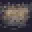

# Course areas and cameras (KMP AREA / CAME)

- Status: verified
- Asked: Let's start a new topic, research the AREA and CAME sections of the kmp fully. Find all area types used by the game and how they work and behave. Find all camera types used by the game and how they work and behave (replay cameras and course intro cameras). In the topic, there must be a section clear and concise directed to course creators that may want to use areas for effects, replays and intro cameras, and any other functionality they may serve.
  - Remark from the user during the research (2026-11-02): the two cameras linked to each other in every course are presumably what the developers used to render the course previews of the menu, which are baked into moflex videos.
  - Follow-up (2026-11-02): settle the open questions, can you patch the goal camera to work and run on emu to see how it would look? do all courses have one, are all the same?
  - Follow-up (2026-11-03): there is area 12 (COURSE), but it is related to CORS. Investigate what that does (it may be a
    development leftover) as well as every other always empty KMP sections.
  - Remark from the user during that follow-up (2026-11-03): cannons use the glider route settings.
- Base commit: db0fec51ce309b67fd45a710492ac344190bb565
- Images: `eur2` (sha1 e3edb9771fea3149ddfe309e3ca8453046ef8a95), `dlp` only as the source of names. The KMP files are those
  of the `eur2` RomFS (the `pat1:/Patch` overrides where they exist). `eur2` also run in Azahar (the installed game with
  its v1.2 update) for the tests of [Finding 16](#16-in-game-tests).

## Contents

- [Overview](#overview): what was researched and found, for readers new to the topic
  - [Words used in this document](#words-used-in-this-document)
  - [The shape of an area](#the-shape-of-an-area)
  - [Area types](#area-types)
  - [Camera areas and the replay cameras](#camera-areas-and-the-replay-cameras)
  - [Camera types](#camera-types)
  - [The goal camera (type 0)](#the-goal-camera-type-0)
  - [The course intro](#the-course-intro)
  - [The award ceremony and the live view](#the-award-ceremony-and-the-live-view)
  - [Environment effect areas](#environment-effect-areas)
  - [Moving road areas](#moving-road-areas)
  - [Sound areas](#sound-areas)
  - [Sections no course fills (CNPT, MSPT, CORS)](#sections-no-course-fills-cnpt-mspt-cors)
  - [Advice for course creators](#advice-for-course-creators)
- [Glossary](#glossary): the classes, members and enums involved, with their offsets; the [functions](#functions) and
  [data](#data) tables with addresses
- [Findings](#findings): each claim with its evidence
  - [Sources and method](#sources-and-method)
  - [1. Area entries and their shapes](#1-area-entries-and-their-shapes)
  - [2. Readers of each area type](#2-readers-of-each-area-type)
  - [3. Building the demo cameras](#3-building-the-demo-cameras)
  - [4. Choosing the camera area](#4-choosing-the-camera-area)
  - [5. Replays and the view after the finish](#5-replays-and-the-view-after-the-finish)
  - [6. The common camera logic](#6-the-common-camera-logic)
  - [7. Camera types one by one](#7-camera-types-one-by-one)
  - [8. Camera routes](#8-camera-routes)
  - [9. The course intro](#9-the-course-intro)
  - [10. Award ceremony and live view](#10-award-ceremony-and-live-view)
  - [11. Environment effect areas](#11-environment-effect-areas)
  - [12. Moving road areas](#12-moving-road-areas)
  - [13. Sound areas](#13-sound-areas)
  - [14. Fields without a reader](#14-fields-without-a-reader)
  - [15. Values used by the original courses](#15-values-used-by-the-original-courses)
  - [16. In-game tests](#16-in-game-tests)
  - [17. What each effect slot shows](#17-what-each-effect-slot-shows)
  - [18. The empty sections: CNPT, MSPT and CORS](#18-the-empty-sections-cnpt-mspt-and-cors)
- [Confidence](#confidence): what is certain, what is likely, what is a guess
- [Open questions](#open-questions): what was not resolved

## Overview

A course file (the KMP) has two sections this research is about. **AREA** holds boxes and cylinders placed in the course,
each with a type that says what happens inside it. **CAME** holds cameras: the shots of the replays and of the course intro.
The two are linked, because the replay shows the camera of the area the kart is in. In short:

- The game reads only four area types: **camera** (type 0), **environment effect** (1), **moving road** (3) and **sound**
  (11). The other values, 2 and 4 to 10, have no reader, and the original courses do not use them
  ([Area types](#area-types)).
- Cameras are only shown through camera areas: a course without any camera area has no replay cameras and no course intro
  ([Finding 3](#3-building-the-demo-cameras)).
- There are nine camera types (0 to 8). Five are used in the replays, one (type 5) in the course intro, and types 7 and 8
  only in the award ceremony. Type 0 is the **goal camera**: 28 race courses have one, but the game never shows it. When
  forced to work in the emulator, it films the driver from the front after the finish line
  ([The goal camera](#the-goal-camera-type-0)).
- The course intro is a chain of cameras linked by their **next** field. Its three shots last 232, 204 and 240 frames
  whatever the KMP says: these lengths are written in the game's code. Only the first three shots of the chain play
  ([The course intro](#the-course-intro)).
- What the effect and sound areas do depends on the course slot the file is loaded in: several course slots have rules of
  their own written in the code ([Environment effect areas](#environment-effect-areas), [Sound areas](#sound-areas)).
- Area type 12 belongs to CORS, one of three sections (with CNPT and MSPT) that every course leaves empty. The game loads
  them and never reads them: they are development leftovers, but a course still has to keep them
  ([Sections no course fills](#sections-no-course-fills-cnpt-mspt-cors)).

All of this was read in the game's code and compared with the files of the original courses. The goal camera, the switch
to the replay cameras after the finish and the states used in replays and at the race start were also checked in the
running game; the rest was not ([Confidence](#confidence)).

### Words used in this document

- An **area** is one entry of AREA; a **camera** is one entry of CAME. A **route** is one entry of POTI, the section of
  the KMP that holds the routes of objects and cameras. A route has two settings of its own, the **route settings**, and
  each of its points has two more, the **point settings**.
- A **course slot** is one of the courses of the game. Custom courses are loaded in place of one course slot,
  and the game's code still applies the rules it has for that original slot.
- The **watched kart** is the kart the camera shows: the player's kart in a race, or the one chosen in a replay.
- The **kart camera** is the normal camera behind the kart, in third or first person. The **demo cameras** are the
  cameras built from CAME. The game switches between the two.
- Distances are in course units, angles in degrees unless said otherwise, and a second is 60 frames.

### The shape of an area

Every area is a box (shape 0) or a cylinder (shape 1), placed at its **position** and turned by its **rotation** (in
radians, as in every MK7 KMP). The position is the centre of the bottom of the area, not its middle, and areas only reach
upward from it ([Finding 1](#1-area-entries-and-their-shapes)):

| Shape | Width (local X) | Height (local Y) | Depth (local Z) |
| --- | --- | --- | --- |
| Box (0) | 1000 × scale X | 0 to 1000 × scale Y above the position | 1000 × scale Z |
| Cylinder (1) | radius 500 × scale X | up to 500 × scale Y above the position, **no bottom** | radius 500 × scale Z |

The cylinder is an ellipse when scale X and scale Z differ. It has no floor: everything below its top counts as inside,
however far down. Any other shape value makes the game skip the area, leaving an empty slot that the code that reads that
area type would trip over ([Finding 1](#1-area-entries-and-their-shapes)).

When several areas of the same type contain the point that is tested, the game keeps the area it found the last time as
long as the point is still inside it. Otherwise camera areas pick the one with the highest **priority** (the byte after
the camera index); the other types take the first one in the file order and ignore the priority.

### Area types

| Type | Name in the templates | What it does | Fields it reads |
| --- | --- | --- | --- |
| 0 | `CAMERA` | while the watched kart is inside, the replay (and the view after the finish) shows the camera given by the camera index | camera index, priority |
| 1 | `ENVIRONMENT_EFFECT` | turns on one of the course's environment effects (rain, snow and the like) while the watched kart is inside | setting 1 (effect slot), setting 2 (delay) |
| 3 | `MOVING_ROAD` | karts on "moving road" collision (KCL type 0x0C) inside it are pushed along a route | route |
| 11 | `SOUND_AREA` | plays an ambient sound, or places a sound such as a river along a route | setting 1, setting 2, route |
| 2, 4–10 | `TYPE_2`, `TYPE_4` … | nothing: no code reads them | |

Type 12 (`COURSE`) is not an AREA type: the game gives it to the entries of another section, CORS, which no original
course fills and nothing reads ([Sections no course fills](#sections-no-course-fills-cnpt-mspt-cors)). The field after
the route (the "enemy" field) and the last two bytes of the entry are never read ([Finding 14](#14-fields-without-a-reader)).

### Camera areas and the replay cameras

When the course loads, the game takes every camera area with a camera index of 0 or more and builds the camera it points
to ([Finding 3](#3-building-the-demo-cameras)). Two kinds of camera are left out: type 0, and cameras whose third byte
(**video next**) is not 0. A camera area whose camera is left out is ignored. Two areas may point to the same camera:
each gets its own copy.

In a **replay**, the game looks every frame for the camera area that holds the watched kart, and cuts to its camera when
the area changes ([Finding 4](#4-choosing-the-camera-area), [Finding 5](#5-replays-and-the-view-after-the-finish)):

- The new camera starts from its beginning (route, field of view, look-at point) at every cut.
- After **19 frames** in no camera area, the replay goes back to the kart camera. It goes back to the demo cameras only
  after the kart has been inside camera areas for **60 frames** in a row. So small gaps between areas are bridged, but a
  kart that leaves the areas for good gets the kart camera.
- While the kart is being carried back by Lakitu, the kart camera is shown too, and the player can switch to first person
  at any time.

At the **end of a race** (Grand Prix, VS and the like, not only replays), once the watched kart has crossed the finish
line, the game keeps the kart camera for **300 frames** (5 seconds) and then, the next time the kart moves into another
camera area, switches to the demo cameras and behaves as in a replay ([Finding 5](#5-replays-and-the-view-after-the-finish)).

### Camera types

The type of a camera chooses how it moves and where it looks. The fields named below are those of the CAME entry, with
the names community tools give them ([Finding 7](#7-camera-types-one-by-one)).

| Type | Used for | Position | Looks at |
| --- | --- | --- | --- |
| 0 | goal camera: the first one is built, never shown ([below](#the-goal-camera-type-0)) | orbits the kart as type 3 | as type 3 |
| 1 | replays | fixed at **position**; with a route, moves along it as type 2 | the watched kart |
| 2 | replays | moves along its **route** | the watched kart |
| 3 | replays | orbits the kart: viewpoint begin = (turn, tilt, distance); a route has no effect | the kart, aim offset by viewpoint end |
| 4 | none of the original courses | fixed at **position**; with a route, moves along it as type 5 | a point moving from **viewpoint begin** to **viewpoint end** |
| 5 | course intro (and one replay camera) | moves along its **route** | a point moving from **viewpoint begin** to **viewpoint end** |
| 6 | replays, award ceremony | follows the kart, with its **route** as offsets around it | the kart, aim offset by viewpoint end |
| 7, 8 | award ceremony | as type 6, but always follows the second (type 7) or third (type 8) driver of the ceremony | as type 6 |
| 9 and more | nothing | the camera keeps its starting state | |

What every type shares:

- **Field of view.** It starts at **FOV begin** and moves toward **FOV end** by **FOV speed** hundredths of a degree per
  frame, then stays at FOV end ([Finding 6](#6-the-common-camera-logic)). A FOV speed of 0 keeps FOV begin.
- **Route.** The code shared by all types moves a camera with a route (any value of 0 or more) along it, at the speed
  of the route points (see below); without a route the camera stays at its position. So type 1 and 2 are the same
  camera, and so are type 4 and 5. Types 0 and 3 then place the camera around the kart, overwriting the route position,
  so a route has no effect on them; types 6 to 8 use it as offsets from the kart
  ([Finding 7](#7-camera-types-one-by-one)).
- **Moving look-at point** (types 4 and 5). The point moves in a straight line from viewpoint begin to viewpoint end at
  **viewpoint speed** hundredths of a unit per frame, then stays at viewpoint end. With a viewpoint speed of 0 it stays at
  viewpoint begin. These two points are absolute course coordinates.
- **Aim offset** (types 0, 3, 6, 7, 8). The camera is first aimed at the kart (the point the kart camera looks at), then
  viewpoint end turns that aim, in degrees: X sideways (around the camera's up direction), Y up or down (around its side
  axis), Z rolls the picture around the view direction. The camera itself does not move; (0, 0, 0) looks straight at the
  kart. Which way a positive value turns was not checked ([Finding 7](#types-3-6-7-and-8-follow-cameras)).
- **Follow cameras** (types 3, 6, 7, 8) use the kart camera's up direction, so they tilt with the kart. A **next** value of
  −2 makes them keep a fixed up direction instead ([Finding 7](#types-3-6-7-and-8-follow-cameras)).
- The camera's **rotation**, the **point speed** and the two **flags** are never read
  ([Finding 14](#14-fields-without-a-reader)).

#### Camera routes

A camera on a route moves at the **first point setting** divided by 100, in units per frame: 250 means 2.5 units per
frame. Between two points, the speed blends from the setting of one point to that of the next, so a point with setting 0
makes the camera slow down as it gets close. The two route settings behave as for other routes: the first one chooses
straight lines (0) or a smooth curve (not 0) through the points; the second chooses a closed loop (0) or an open route,
which a camera runs back and forth ([Finding 8](#8-camera-routes)).

For type 6, 7 and 8 cameras, the route points are **offsets from the kart**, along the course axes (they do not turn with
the kart). In the original courses and the award ceremony, 71 of the 178 such cameras have a route close around the
origin, between about 30 and 65 units from it, so that the camera circles the kart; the others have routes that reach
100 to 300 units from the origin (the last camera of the award ceremony over 1000), so that the camera moves away from or
toward the kart ([Finding 7](#types-3-6-7-and-8-follow-cameras), [Finding 8](#8-camera-routes)).

### The goal camera (type 0)

When the course loads, the game builds the first type 0 camera of CAME as its **goal camera**, meant to be shown for the
first 5 seconds after the player crosses the finish line, before the replay cameras take over. The code that would make it
the current camera is cut short: it loads the goal camera and then sets "no camera" instead, the same in every build,
v1.0, v1.1 and v1.2 and the Download Play build made before v1.0
([Finding 5](#5-replays-and-the-view-after-the-finish)). So in the retail game the kart camera stays during those 5
seconds.

A type 0 camera works like type 3: it orbits the kart at the turn, tilt and distance of viewpoint begin, and offsets its aim
by viewpoint end. Forced on in the emulator (one instruction changed, the camera initialised and the screen switched to the
demo cameras), the goal camera of Toad Circuit films the kart from the front-left, a little above, following it as the AI
drives on; after the 5 seconds the game cuts to the replay camera of the next area, as designed
([Finding 16](#16-in-game-tests)).

28 of the 32 race courses have a goal camera; Mario Circuit, Daisy Hills, Wuhu Loop and Wii Maple Treeway, the battle
courses and the award ceremony have none. 25 of them use the same values: viewpoint begin (160, −15, 50), that is turned
160° from behind the kart (so in front of it), 15° from above, 50 units away; viewpoint end (0, −12, 0); FOV 40. Only the
position and rotation differ, and they are not used. The exceptions ([Finding 15](#15-values-used-by-the-original-courses)):

| Course | Difference | In game |
| --- | --- | --- |
| Wario Shipyard | FOV 20 | a tighter shot (not run) |
| Rainbow Road | FOV speed 8 (counted among the 25: with FOV begin = FOV end it changes nothing) | not run |
| SNES Mario Circuit 2 | viewpoint begin (0, −5, 45), end (0, −5, 0), FOV 45 | a low chase shot from behind, much like the kart camera |
| DS Airship Fortress | viewpoints all 0, FOV 60 | broken: a distance of 0 puts the camera on the point it looks at, and the top screen shows a garbled view |

### The course intro

Before each Grand Prix race, the game shows the course intro, a scene of its own that lasts **700 frames** unless the player
skips it. It plays the cameras of the intro chain ([Finding 9](#9-the-course-intro)):

1. The chain is found from the first camera in the file with a **duration** above 0 and a video next of 0. From there
   the game goes back through the cameras whose **next** points to it, to find the first camera of the chain, then
   follows the next fields until one is negative.
2. Shot 1 lasts 232 frames, shot 2 204 frames and shot 3 240 frames. These lengths are written in the code; the duration
   field of the KMP does not change them. A fourth camera would get a length read from unrelated data (over a billion
   frames), so in practice it would play until the intro ends. All the original courses use exactly three cameras, of
   type 5, with durations 232, 204 and 240.
3. The **last** camera of the chain behaves differently from the others if it is type 5: its look-at point moves from
   viewpoint begin to viewpoint end in **duration** frames, fast at first and slowing down at the end, and its viewpoint
   speed is not used.
4. The karts are hidden during the first two shots and appear at the start of the third.
5. During the intro the camera does not draw what is closer than 30 units (the race uses 3), except on Cheep Cheep Lagoon,
   Wario Shipyard, Koopa Cape and DK Pass. On Cheep Cheep Lagoon, Wario Shipyard and Koopa Cape, an underwater fog is used
   when the camera starts a shot below the water.

After the third shot (676 frames) the camera stops moving and stays on its last view until the 700 frames are over.

Every course also has two more type 5 cameras with a video next other than 0, which in every course but SNES Mario
Circuit 2 point to each other (there they point to the first two intro cameras, whose routes they share). The game never
uses them: they are left out of the replays, and nothing links them into the intro. As remarked when this research was
asked, they are most likely the cameras that rendered the course preview videos of the menu, which are stored as videos
(`UI/mobiclip/CourseSelectRace.moflex` and `CourseSelectBattle.moflex`); the battle courses, which have no intro, have
such a pair too ([Finding 15](#15-values-used-by-the-original-courses)).

### The award ceremony and the live view

- The **award ceremony** after a Grand Prix (the Toad Circuit winning run, `Gctr_WinningRun`) plays its intro chain too,
  but each camera lasts its own **duration** from the KMP, so any number of cameras works there. Its chain has five
  cameras: a type 5, then types 6, 8, 7 and 6. The ceremony puts the winner in kart 0, the second in kart 1 and the
  third in kart 2, so type 6 follows the winner, type 7 the second and type 8 the third
  ([Finding 10](#10-award-ceremony-and-live-view)).
- The **live view** is a mode the game marks with a flag of its own in the race information; which screen of the game
  uses it was not researched. It uses the third camera of the intro chain, computed once as a still image, and only if
  the chain has exactly three cameras ([Finding 5](#5-replays-and-the-view-after-the-finish),
  [Finding 10](#10-award-ceremony-and-live-view)).

### Environment effect areas

Environment effect areas switch on the particle effects of a course (falling leaves, snow, sparkles and the like) while
the watched kart is inside them ([Finding 11](#11-environment-effect-areas)). Two things decide what appears, and only
one of them is in the KMP:

- **Which particles** a course slot has is not in the course files. It is a row of four tables in `RaceCommon.szs`, the
  archive shared by every course (`Effect/GPUPtclEnv0.bin` to `GPUPtclEnv3.bin`, one table per **effect slot** 0 to 3, one
  row per course slot), with textures from `Effect/Menu/GPUEnvPtcl.ctpk` in `Common.szs`
  ([Finding 17](#17-what-each-effect-slot-shows)). A custom course loaded in a course slot gets that slot's particles.
- **Where they appear** is decided by the effect areas of the KMP and by rules in the game's code, some of them specific to
  a course slot.

Each effect area has two settings:

- **Setting 1** chooses what the area switches on, 0 to 3 (see the table).
- **Setting 2** is a delay: during the first setting 2 seconds after the countdown starts, the area switches nothing on.
  On Neo Bowser City, DK Pass and Kalimari Desert the area still switches off what shows outside the areas, and on Neo
  Bowser City still switches on effect slot 2.

When areas overlap, the one found first in the file wins (the one the kart was already in wins while it stays inside);
the priority byte is not used. During the course intro, and in a few other modes
([Finding 11](#11-environment-effect-areas)), the position of the camera is tested instead of that of the kart.

#### The particle textures

The 17 textures the effect rows can use, in the order the game numbers them (enlarged, on a dark background). The game
numbers them in a different order from the one they are stored in ([Finding 17](#17-what-each-effect-slot-shows)).

| Index | Texture | Image | What it is |
| --- | --- | --- | --- |
| 0 | `envpaper` |  | four colour strips (red, yellow, green, white), one per frame: confetti |
| 1 | `envflower` |  | a pink petal |
| 2 | `envsmoke` |  | a brown puff of dust |
| 3 | `envfire` |  | an orange ember |
| 4 | `envsnow` |  | a small white snowflake |
| 5 | `envspore` |  | a dull green dot |
| 6 | `envmaple` |  | an orange maple leaf |
| 7 | `envglow` |  | a soft grey glowing dot |
| 8 | `envdia` |  | a lilac four-pointed sparkle |
| 9 | `envwater` |  | a water ring (bubble) |
| 10 | `envteresa` |  | four frames of a Boo |
| 11 | `envrain` |  | a white raindrop |
| 12 | `envfish` |  | four frames of fish |
| 13 | `fireball` |  | an orange glowing ball; no row uses it |
| 14 | `smoke04` |  | a brown smoke puff; no row uses it |
| 15 | `lightline` |  | a dark blue light streak |
| 16 | `stardust` |  | a white star dot |

#### What to expect on each course slot

The table says, for each course slot a custom course may be loaded in, what is shown outside every effect area, inside an
area of each setting 1, and under water. The names are those of the textures above; each slot's row also sets how many
particles there are, how they move and their colour. Checked in game: the rain of Neo Bowser City and the snow of DK Pass
(effect slot 0 of each), and the textures of all four effect slots of DK Pass ([Finding 16](#16-in-game-tests)).

"Under water" applies only where the game tracks a water surface for the kart (the courses where karts can dive). There,
effect slot 1 shows while the kart is under water and areas with setting 1 = 1 no longer switch it; elsewhere, effect
slot 1 follows the areas with setting 1 = 1.

Most rows place their particles around the camera. Some rows place them instead at a **fixed point of the course**, given
in the row (marked "at (x, y, z)"): on the original course that point is about 270 to 1000 units from the effect area
that switches the effect slot, mostly above it, so the particles fill that part of the course. On a custom course they
still appear at those coordinates, wherever they fall on the new layout, and only while an area switches the effect slot
on. Neo Bowser City's effect slot 1 is rain that only shows far from the camera ("far away only"): rain seen from under a
roof or inside a tunnel.

| Course slot | Outside every effect area | Area, setting 1 = 0 | = 1 | = 2 | = 3 | Under water |
| --- | --- | --- | --- | --- | --- | --- |
| Mario Circuit | nothing | `envflower` | `envglow` | `envfire` | `envpaper` | `envglow` |
| Rock Rock Mountain | nothing | `envflower` | `envglow` | `envfire` | `envpaper` | `envglow` |
| Cheep Cheep Lagoon | nothing | `lightline` | `envglow` | `envfire` | `envpaper` | `envglow` |
| Daisy Hills | nothing | `envflower` | `envglow` | `envfire` | `envpaper` | `envglow` |
| Toad Circuit | nothing | `envpaper` | `envglow` | `envfire` | `envpaper` | `envglow` |
| Shy Guy Bazaar | nothing | `envsmoke` | `envglow` | `envfire` | `envpaper` | `envglow` |
| Neo Bowser City | near rain: `envrain` around the camera | near rain off; `envrain` at (150, 148, -3005) | near rain off; `envrain` far away only + `envrain` at (150, 148, -3005) + `envrain` at (620, 618, -726) | near rain off; `envrain` at (150, 148, -3005) | near rain off; `envrain` at (150, 148, -3005) + `envrain` at (620, 618, -726) | nothing |
| DK Jungle | nothing | `envglow` | `envglow` | `envfire` | `envpaper` | `envglow` |
| Wuhu Loop | nothing | `envflower` | `envglow` | `envfire` | `envpaper` | `envglow` |
| Maka Wuhu | nothing | `envflower` | `envglow` | `envfire` | `envpaper` | `envglow` |
| Rosalina's Ice World | nothing | `envdia` | `envglow` | `envfire` | `envpaper` | `envglow` |
| Bowser's Castle | nothing | `envfire` | `envwater` | `envfire` | `envpaper` | `envwater` |
| Piranha Plant Slide | nothing | `envflower` | `envwater` | `envfire` | `envpaper` | `envwater` |
| Rainbow Road | nothing | `stardust` | `envglow` | `envfire` | `envpaper` | `envglow` |
| Wario Shipyard | nothing | `envfish` at (5120, 1420, 420) | `envglow` | `envfish` at (3220, 1200, 2260) | `envfish` at (3380, 1440, 3380) | `envglow` |
| Music Park | nothing | `envflower` | `envglow` | `envfire` | `envpaper` | `envglow` |
| Wii Coconut Mall | nothing | `envflower` | `envglow` | `envfire` | `envpaper` | `envglow` |
| Wii Koopa Cape | nothing | `envfish` at (760, 744, 1080) | `envglow` | `envfish` at (760, 744, 1080) + `lightline` + `envfish` at (1980, 616, 1240) | `envfish` at (1980, 616, 1240) | `envglow` |
| Wii Maple Treeway | nothing | `envmaple` | `envglow` | `envfire` | `envpaper` | `envglow` |
| Wii Mushroom Gorge | nothing | `envspore` | `envglow` | `envfire` | `envpaper` | `envglow` |
| DS Luigi's Mansion | nothing | `envteresa` | `envglow` | `envfire` | `envpaper` | `envglow` |
| DS Airship Fortress | nothing | `envflower` | `envglow` | `envfire` | `envpaper` | `envglow` |
| DS DK Pass | near snow: `envsnow` around the camera | near snow off | near snow off | near snow off; `envfire` | near snow off; `envpaper` | nothing |
| DS Waluigi Pinball | nothing | `envflower` | `envglow` | `envfire` | `envpaper` | `envglow` |
| GCN Dino Dino Jungle | nothing | `envflower` | `envglow` | `envfire` | `envpaper` | `envglow` |
| GCN Daisy Cruiser | nothing | `envflower` | `envfish` at (28, 370, 1200) | `envfire` | `envpaper` | `envfish` at (28, 370, 1200) |
| N64 Luigi Raceway | nothing | `envpaper` | `envglow` | `envfire` | `envpaper` | `envglow` |
| N64 Kalimari Desert | near dust: `envsmoke` around the camera | near dust off | near dust off | near dust off; `envfire` | near dust off; `envpaper` | nothing |
| N64 Koopa Beach | nothing | `envfish` at (-1100, 200, 1620) | `envglow` | `envfire` | `envpaper` | `envglow` |
| GBA Bowser Castle 1 | `envfire` | `envfire` | `envfire` | `envfire` | `envfire` | nothing |
| SNES Mario Circuit 2 | nothing | `envflower` | `envglow` | `envfire` | `envpaper` | `envglow` |
| SNES Rainbow Road | nothing | `stardust` | `envglow` | `envfire` | `envpaper` | `envglow` |
| Wuhu Town | nothing | `envflower` | `envglow` | `envfire` | `envpaper` | `envglow` |
| Honeybee Hive | nothing | `envflower` | `envglow` | `envfire` | `envpaper` | `envglow` |
| Sherbet Rink | nothing | `envglow` | `envglow` | `envfire` | `envpaper` | `envglow` |
| DS Palm Shore | nothing | `envflower` | `envglow` | `envfire` | `envpaper` | `envglow` |
| N64 Big Donut | nothing | `envflower` | `envglow` | `envfire` | `envpaper` | `envglow` |
| GBA Battle Course 1 | nothing | `envflower` | `envglow` | `envfire` | `envpaper` | `envglow` |
| Award ceremony | nothing | `envpaper` | `envglow` | `envfire` | `envpaper` | `envglow` |

Notes:

- **Neo Bowser City**: its rain (effect slot 0) falls around the camera everywhere, and any effect area stops it. What
  the areas switch on instead is rain that does not fall on the kart: effect slot 2, at a fixed point (on the original
  course near the area with setting 1 = 2), effect slot 3 at another fixed point (near the area with setting 1 = 3), and
  with setting 1 = 1 effect slot 1, rain visible only far away. So inside its tunnels and buildings the rain stops on the
  kart but stays visible outside. This is also why effect slots 1 to 3 forced on at the start line showed nothing.
- **DK Pass and Kalimari Desert**: the particles show everywhere, and any effect area switches them off. Areas with
  setting 1 = 0 or 1 only do that; 2 and 3 also switch on effect slot 2 or 3.
- **Koopa Cape**: setting 1 = 2 switches on three effect slots at once.
- **GBA Bowser Castle 1**: its particles are always on; effect areas do nothing.
- Most course slots share the same rows for effect slots 1 to 3 (`envglow` rising slowly, `envfire` rising, `envpaper`
  confetti falling). A few have an effect slot 1 of their own: `envwater` rising on Bowser's Castle and Piranha Plant Slide,
  `envfish` on GCN Daisy Cruiser.
- Effect slot 0 also keeps an environment sound going (and effect slot 1 on Neo Bowser City); which sound was not
  researched.

### Moving road areas

A moving road area pushes karts along a route, like the currents of Piranha Plant Slide or the river of Koopa Cape
([Finding 12](#12-moving-road-areas)):

- It only acts on karts driving on collision of type 0x0C ("moving road", `PULL` in the templates). The area alone does
  nothing, and that collision without an area does nothing either.
- The **route** gives the direction: from each route point toward the next one.
- The **first point setting** of each route point, divided by 100, sets how strongly the karts are pushed near that
  point; the strength blends between points.
- The area's own settings are not read. Up to 64 routes can be used by moving road areas.

### Sound areas

A sound area is one of two kinds, chosen by its route ([Finding 13](#13-sound-areas)). Each kind may have at most 10 areas
in a course; more would overflow a table of the game. Sound areas test the position of the **listener**, the point the
game plays the course's sounds for; it is most likely the camera ([Confidence](#confidence)).

#### Ambient sound areas (route −1 or 0)

The low byte of **setting 1** chooses an ambient loop that plays while the listener is inside; outside every such area, the
course's default ambient plays. Route 0 counts as "no route" here, so route 0 cannot be used for a route sound area.

| Setting 1 | Sound | Used by |
| --- | --- | --- |
| 0, 1, 2, 3 | none: stops the ambient loop; nothing else in the game tells them apart | many courses (tunnels, indoor parts) |
| 4 | `SE_ENV_FOREST` | Rock Rock Mountain |
| 5 | `SE_ENV_JUNGLE` | DK Jungle |
| 6 | `SE_ENV_AUDIENCE_MII_STEREO` | Wuhu Loop |
| 7 | `SE_ENV_AUDIENCE` | Toad Circuit, award ceremony |
| 8 | `SE_ENV_THUNDER` | Luigi's Mansion |
| 9 | `SE_CRD_LM_MORITORI` | Luigi's Mansion |
| 10 | no loop; changes the race music (the "moon" variation) | Rainbow Road |
| 11 | `SE_CRD_KS_AIRSHIP_WIND`; also tells the cannons of DS Airship Fortress that the listener is outside | none (default of Airship Fortress) |
| 12 | `SE_CRW_KNK_ENV_WIND` | Bowser's Castle |
| 13 | `SE_CRG_DJ_ENV_JUNGLE` | Dino Dino Jungle |
| 14 | `SE_ENV_MAGMA` | none (default of GBA Bowser Castle 1) |
| 15 | `SE_CN_GL_ENV_TOWN` | Daisy Hills |
| 16 | `SE_CN_RBW_PIPE_ROLL` | Rainbow Road |
| 17 | no loop; the tempo area of Music Park | Music Park |
| 18 | `SE_ENV_UNDERWATER` (meant for the underwater state, which the game sets itself) | none |

The default ambient outside the areas is set by the course slot: thunder on Wario Shipyard, wind on Mushroom Gorge, airship
wind on Airship Fortress, magma on GBA Bowser Castle 1, and none elsewhere. While the listener is under water the areas are
not checked at all.

#### Route sound areas (route 1 or more)

While the listener is inside the area, a sound is placed on the route, at the point of the route closest to the listener,
so that a river or a shore sounds as long as the whole route. **Setting 1** chooses the sound:

| Setting 1 | Sound | Setting 1 | Sound |
| --- | --- | --- | --- |
| 0 | `SE_ENV_RIVER` | 9 | `SE_CN_KPC_PIPE_ROLL` |
| 1 | `SE_ENV_RIVER_L` | 10 | `SE_CN_RBW_PIPE_ROLL` |
| 2 | `SE_ENV_WATER_FALL` | 11 | `SE_ENV_CRUISER_SEA` |
| 3 | `SE_ENV_WATER_FALL_L` | 12 | `SE_ENV_MAGMA` |
| 4 | `SE_ENV_OUTER_SEA` | 13 | `SE_CN_RC_CLIFF_WIND` |
| 5, 6 | sea shore waves (`SE_ENV_SEA_SHORE_COME` / `_BACK`), a pair | 14 | `SE_ENV_NIGHT_SEA` |
| 7 | `SE_ENV_MAGMA_MONO` | 15, 16 | outer and inner sea shore (`SE_ENV_SEA_SHORE_OUTER` / `_INNER`), a pair |
| 8 | `SE_CN_KPC_LAVA_FLOW_L` | | |

**Setting 2** chooses how the route is used: 0, the closest point of the route in 3D; 1, the same but ignoring heights
(the sound is at the listener's height); 2, only the height of the first route point is used, as a flat surface such as the
sea: the sound is right above or below the listener ([Finding 13](#route-sound-areas)).

### Sections no course fills (CNPT, MSPT, CORS)

A KMP has 18 sections. Three of them have no entries in any course file of the game (all 48 KMP files of the RomFS):
**CNPT**, **MSPT** and **CORS**. (KTPT, the start points, is empty on race courses only; battle courses and the award
ceremony use it.) The game still loads all three when a course loads, and then never reads them again: they are
development leftovers ([Finding 18](#18-the-empty-sections-cnpt-mspt-and-cors)).

| Section | Name in the game's code | Entry | What the game does with it |
| --- | --- | --- | --- |
| CNPT | cannon points (`MapdataCannonPoint`) | 0x1C bytes: position, rotation, 4 more bytes | builds a rotation matrix for each entry; nothing reads the entries |
| MSPT | mission points (`MapdataMissionPoint`) | 0x1C bytes: position, rotation, 4 more bytes | the same as CNPT; nothing reads the entries |
| CORS | course (`MapdataCourse`) | 0x2C bytes: a box or cylinder like an area, without type and settings | builds a box or cylinder test of area type 12 for each entry; nothing calls the test |

Both point sections are laid out like the start points (KTPT). Mario Kart Wii has sections with the same magics, which
community documentation (not checked here) describes as the targets of the cannons and the end positions of missions.
In this game the cannon of Maple Treeway most likely uses the glide route instead, as remarked when this research was
asked: the first glide path of that course starts at the cannon, and only this path and one on each of two other courses
carry a mark the cannon tests; the glide route itself was not researched. CORS has no counterpart in earlier games. Its entries are areas without a type, a camera index or
settings, so the game gives them type 12 itself. That points to a plan for marking out parts of the course that was
dropped before release; the code gives no hint of what it was for.

The game refuses a KMP whose header does not list exactly 18 sections, and it reads through a null pointer when it
cannot find one of the 18 by name. So a course has to keep all three sections, even when they are empty. Entries added to them
only cost memory: no code reads them (not tried in game).

### Advice for course creators

#### Areas in general

- Place the area's **position at its bottom**: areas only grow upward. A box is 1000 units wide per unit of scale; a
  cylinder has a radius of 500 per unit of scale and a height of 500 per unit of scale Y.
- A **cylinder has no bottom**: it also covers everything below it. Use a box where something underneath must stay out.
- Use only shapes 0 and 1, and only types 0, 1, 3 and 11. Other types do nothing; other shapes can crash the game.
- Keep the **CNPT, MSPT and CORS** sections in the file, empty. The game needs all 18 sections, with these magics and
  version 0xC1C or later in the header; entries in these three do nothing.
- The rotation is in radians. Tools that show degrees convert it.

#### Replay cameras

- Without at least one camera area, the course has **no replay cameras and no intro** at all.
- Cover the **whole track** with camera areas, with a little overlap. Gaps shorter than 19 frames of driving are bridged,
  longer ones fall back to the kart camera for at least a second.
- Where areas overlap, set a higher **priority** on the one that should win. The current area always wins while the kart is
  still in it, so overlaps cause no flicker.
- Good camera types for replays: 1 (fixed, looks at the kart), 2 (on a route, looks at the kart), 3 (orbits the kart; set
  viewpoint begin to turn, tilt and distance, for example (−12, −24, 53) as on a camera of Mario Circuit), and 6 (circles
  the kart: give it a small route around (0, 0, 0)).
- Each cut restarts the camera from the beginning of its route and field of view: make routes and FOV changes that look
  good from the start.
- Keep **video next at 0** and don't use type 0 for cameras an area points to; such cameras are left out.
- The replay cameras are also used after the player crosses the finish line, after 5 seconds.
- A type 0 (goal) camera is never shown by the retail game. If you add one for mods that turn it on, copy the usual
  values: viewpoint begin (160, −15, 50), viewpoint end (0, −12, 0), FOV 40; never a distance (viewpoint begin Z) of 0.

#### Course intro

- Make a chain of **three** cameras, the first with a **duration** above 0, linked by **next** (the last one −1), and set
  video next to 0. Type 5 is the usual choice: a route for the camera, viewpoint begin and end for where it looks.
- Plan each shot for **232, 204 and 240 frames**, whatever durations you write. Still give each camera a duration above 0,
  and for the third one the duration sets how long its look-at point takes to travel (240 matches the shot).
- Keep the duration of every camera that is not in the chain at 0. A camera with a duration and a video next of 0 that is
  not linked to the others could be taken as the start of the chain.
- Never link the cameras in a loop (the last camera's next pointing back into the chain): the game would search forever
  when the course loads.
- Karts only appear in the third shot, so end the intro on the start line.
- Nothing closer than 30 units to the intro camera is drawn on most course slots.
- The award ceremony (only `Gctr_WinningRun`) uses the camera durations from the KMP instead.

#### Effects and sound

- Effect and sound areas behave according to the **course slot** the custom course replaces: check the tables above for
  the slot you use. On Neo Bowser City, DK Pass and Kalimari Desert, effect areas turn the weather **off**.
- What an effect slot shows is set for the course slot in `RaceCommon.szs`, not in the course files; the area only
  switches it on or off.
- Use **setting 2** of an effect area to delay it, in seconds after the countdown.
- At most 10 ambient and 10 route sound areas. Route sound areas need a route of **1 or more**.
- Moving road areas need both the area (with a route) and road collision of type 0x0C; set the push strength with the
  first point setting of the route points.

## Glossary

### Field::MapdataAreaData (size 0x30, template/Field/Entry/Area.hpp)

One AREA entry, as stored in the KMP.

| Member | Offset | Type | Status | Note |
| --- | --- | --- | --- | --- |
| `m_shape` | 0x00 | `eMapdataAreaShape` | existing | 0 box, 1 cylinder; other values get no calculator |
| `m_type` | 0x01 | `eMapdataAreaType` | existing | |
| `m_came_index` | 0x02 | `s8` | existing | camera areas only |
| `m_priority` | 0x03 | `u8` | new | read only by `DemoCameraDirector::calcInAreaIndex_` |
| `position` | 0x04 | `sead::Vector3f` | existing | centre of the bottom of the area |
| `rotation` | 0x10 | `sead::Vector3f` | existing | radians |
| `scale` | 0x1C | `sead::Vector3f` | existing | |
| `m_setting1` | 0x28 | `u16` | existing | per type |
| `m_setting2` | 0x2A | `u16` | existing | per type |
| `m_route_id` | 0x2C | `s8` | existing | moving road and sound areas |
| `m_enemy_id` | 0x2D | `s8` | existing | no reader |

#### Field::eMapdataAreaType (enum class : u8)

Existing; the patch only adds comments.

| Value | Name | Status | Note |
| --- | --- | --- | --- |
| 0 | `CAMERA` | existing | read by `Demo::DemoCameraDirector` |
| 1 | `ENVIRONMENT_EFFECT` | existing | read by `Effect::KartEffect::_calcEnvEffect` |
| 2 | `TYPE_2` | existing | no reader |
| 3 | `MOVING_ROAD` | existing | read by `Kart::PullPath`, `Kart::Director::createBeforeStructure` |
| 4–10 | `TYPE_4` … `TYPE_10` | existing | no reader |
| 11 | `SOUND_AREA` | existing | read by `Sound::SndAreaMgr::initArea` |
| 12 | `COURSE` | existing | given to CORS entries by `MapdataCourseAccessor::constructLocal`; no reader. The template's comment named a class `MapdataAreaCourse`, which does not exist; the patch names `MapdataCourse` |

### Field::MapdataArea (size 0x8, template/Field/Entry/Area.hpp)

The game's object for one area: a pointer to its `MapdataAreaData` and its shape calculator, `m_area_calc`.

### Field::MapdataAreaCalcBase (size 0x40, template/Field/Entry/Area.hpp)

The shape test of an area. `isInside` does a quick test against `m_bound_radius_sq`, then calls the virtual
`isInsideShape` of the shape.

| Member | Offset | Type | Status | Note |
| --- | --- | --- | --- | --- |
| `m_bound_radius_sq` | 0x04 | `f32` | new | box: sum of the squares of `m_extent`; cylinder: radius X² + radius Z² |
| `m_extent` | 0x08 | `sead::Vector3f` | new | box: 500·scale.x, 1000·scale.y, 500·scale.z; cylinder: 500·scale for all three |
| `m_axes` | 0x14 | `sead::Matrix33f` | new | the rotation matrix of `rotation`, stored with the local axes as rows |
| `m_area_point_data` | 0x38 | `SMapdataAreaCalcData *` | existing | retyped by the patch, was `MapdataArea::SData *` (commented `SMapdataAreaCalcData?`); points to `position` of the entry (entry + 4), not to the entry |
| `m_area_shape` | 0x3C | `eMapdataAreaShape` | existing | |
| `m_area_type` | 0x3D | `eMapdataAreaType` | existing | what the readers of the areas test |

#### Field::MapdataAreaCalcBase::SMapdataAreaCalcData (size 0x24, template/Field/Entry/Area.hpp)

New; named after the `dlp` symbols of the calculator constructors (`MapdataAreaCalcBox(const
MapdataAreaCalcBase::SMapdataAreaCalcData*, eMapdataAreaType)`). The part of an AREA or CORS entry the calculator reads.

| Member | Offset | Type | Status | Note |
| --- | --- | --- | --- | --- |
| `position` | 0x00 | `sead::Vector3f` | new | entry + 0x04 |
| `rotation` | 0x0C | `sead::Vector3f` | new | entry + 0x10 |
| `scale` | 0x18 | `sead::Vector3f` | new | entry + 0x1C |

### Field::MapdataAreaCalcCylinder (size 0x48, template/Field/Entry/Area.hpp)

The cylinder calculator. The template declared it as a plain class of 0x40 bytes; the game allocates 0x48.

| Member | Offset | Type | Status | Note |
| --- | --- | --- | --- | --- |
| `m_radius_sq` | 0x40 | `f32` | new | (500·scale.x)² |
| `m_radius_ratio` | 0x44 | `f32` | new | scale.x / scale.z, turns the ellipse into a circle |

### Field::MapdataCannonPointData, Field::MapdataMissionPointData (size 0x1C, template/Field/Entry/CannonPoint.hpp, MissionPoint.hpp)

One CNPT or MSPT entry, as stored in the KMP; both have the same layout. The template declared no members.

| Member | Offset | Type | Status | Note |
| --- | --- | --- | --- | --- |
| `position` | 0x00 | `sead::Vector3f` | new | not read; named after the layout of the other point sections |
| `rotation` | 0x0C | `sead::Vector3f` | new | radians; read only to build `m_posture` |

### Field::MapdataCannonPoint, Field::MapdataMissionPoint (size 0x28, template/Field/Entry/CannonPoint.hpp, MissionPoint.hpp)

The game's object for one CNPT or MSPT entry.

| Member | Offset | Type | Status | Note |
| --- | --- | --- | --- | --- |
| `m_posture` | 0x04 | `sead::Matrix33f` | new | was an unnamed `/U/` member; the rotation matrix of `rotation`, never read |

### Field::JmpResourceCourse (size 0x58, template/Field/JmpResourceCourse.hpp)

The loaded KMP (`Field::CourseInfo` derives from it), with one accessor per section. Only the members the findings
refer to are listed.

| Member | Offset | Type | Status | Note |
| --- | --- | --- | --- | --- |
| `m_area_accessor` | 0x34 | `MapdataAreaAccessor *` | existing | AREA |
| `m_camera_accessor` | 0x38 | `MapdataCameraAccessor *` | existing | CAME |
| `m_cannon_point_accessor` | 0x40 | `MapdataCannonPointAccessor *` | existing | CNPT; written by `mount` only, never read |
| `m_mission_point_accessor` | 0x44 | `MapdataMissionPointAccessor *` | existing | MSPT; written by `mount` only, never read |
| `m_stage_accessor` | 0x48 | `MapdataStageAccessor *` | existing | STGI |
| `m_course_accessor` | 0x4C | `MapdataCourseAccessor *` | existing | CORS; written by `mount` only, never read. The accessor is 0x1C bytes, one word more than those of CNPT and MSPT (set to 0) |
| `m_glide_path_accessor` | 0x54 | `MapdataGlidePathAccessor *` | existing | GLPH |

### Util::JmpResource (size 0x10, template/Util/JmpResource.hpp)

The base of `JmpResourceCourse`: a KMP file checked by `mount`.

| Member | Offset | Type | Status | Note |
| --- | --- | --- | --- | --- |
| `m_header` | 0x04 | `Header *` | existing | the file, null when `mount` refuses it |
| `m_magic` | 0x08 | `u32` | existing | the magic the file must start with |
| `m_accessor_num` | 0x0C | `size_t` | existing | the number of sections the header must list, 18 |

### Field::FieldDirector (size 0x2AC, template/Field/FieldDirector.hpp)

| Member | Offset | Type | Status | Note |
| --- | --- | --- | --- | --- |
| `m_course_info` | 0x38 | `CourseInfo *` | existing | the loaded KMP |

### Field::MapdataCamera (size 0x2C, template/Field/Entry/Camera.hpp)

The game's object for one camera.

| Member | Offset | Type | Status | Note |
| --- | --- | --- | --- | --- |
| `m_path` | 0x00 | `MapdataPath *` | existing | the route of `SData::m_route_id` |
| `m_data` | 0x04 | `SData *` | existing | the CAME entry |
| `m_posture` | 0x08 | `sead::Matrix33f` | new | was an unnamed `/U/` member; made from position and rotation, no reader found |

#### Field::MapdataCamera::EType (enum class : u8)

New; named by this research after the classes `DemoCameraDirector::createCamera_` builds for each value.

| Value | Name | Status | Note |
| --- | --- | --- | --- |
| 0 | `GOAL` | new | `Demo::DemoCameraGoal` |
| 1 | `FIXED` | new | `Demo::DemoCameraFixed` |
| 2 | `PATH` | new | `Demo::DemoCameraPath` |
| 3 | `FOLLOW` | new | `Demo::DemoCameraFollow` |
| 4 | `FIXED_MOVE_AT` | new | `Demo::DemoCameraFixedMoveAt` |
| 5 | `PATH_MOVE_AT` | new | `Demo::DemoCameraPathMoveAt`, or `DemoCameraPathMoveAt2` for the last intro camera |
| 6 | `FOLLOW_PATH` | new | `Demo::DemoCameraFollowPath`, watched kart |
| 7 | `FOLLOW_PATH_KART_1` | new | `Demo::DemoCameraFollowPath`, kart 1 |
| 8 | `FOLLOW_PATH_KART_2` | new | `Demo::DemoCameraFollowPath`, kart 2 |

### Field::MapdataCamera::SData (size 0x48, template/Field/Entry/Camera.hpp)

One CAME entry. The template declared it with size 0x1C and no members. The names are those of KMPExpander, made to the
template conventions.

| Member | Offset | Type | Status | Note |
| --- | --- | --- | --- | --- |
| `m_type` | 0x00 | `EType` | new | |
| `m_next` | 0x01 | `s8` | new | intro chain link; −2 also read by the follow cameras |
| `m_video_next` | 0x02 | `u8` | new | non-zero: no area camera is built from it, and the intro chain search does not start from it |
| `m_route_id` | 0x03 | `s8` | new | |
| `m_point_speed` | 0x04 | `u16` | new | no reader |
| `m_fov_speed` | 0x06 | `u16` | new | × 0.01 degree per frame |
| `m_viewpoint_speed` | 0x08 | `u16` | new | × 0.01 unit per frame |
| `m_start_flag` | 0x0A | `u8` | new | no reader |
| `m_video_flag` | 0x0B | `u8` | new | no reader |
| `m_position` | 0x0C | `sead::Vector3f` | new | |
| `m_rotation` | 0x18 | `sead::Vector3f` | new | used only for `MapdataCamera::m_posture` |
| `m_fov_begin` | 0x24 | `f32` | new | degrees |
| `m_fov_end` | 0x28 | `f32` | new | degrees |
| `m_viewpoint_begin` | 0x2C | `sead::Vector3f` | new | |
| `m_viewpoint_end` | 0x38 | `sead::Vector3f` | new | |
| `m_duration` | 0x44 | `f32` | new | frames |

### Demo::DemoCameraDirector (size 0xA4, template/Demo/DemoCameraDirector.hpp)

Builds the demo cameras and decides which one is shown. Its state (`EState`, existing) is one of `WAIT`, `NORMAL`
(replays and after the finish), `NORMAL_WITH_DUMMY_START`, `START`, `GOAL`, `COURSE` (course intro), `WINNING_RUN`,
`WATCH_IMAGE` (live view).

| Member | Offset | Type | Status | Note |
| --- | --- | --- | --- | --- |
| `m_mapdata_area_array` | 0x34 | `sead::PtrArray<Field::MapdataArea>` | existing | the camera areas whose camera was built |
| `m_area_cameras` | 0x40 | `sead::PtrArray<Demo::DemoCameraBase>` | existing | one camera per entry of `m_mapdata_area_array`; the patch only rewrites its comment |
| `m_demo_cameras` | 0x4C | `sead::PtrArray<Demo::DemoCameraBase>` | existing | the intro chain; the patch only rewrites its comment |
| `m_current_camera` | 0x58 | `Camera::CameraBase *` | existing | the screen camera the demo cameras write to |
| `m_current_demo_camera` | 0x5C | `Demo::DemoCameraBase *` | existing | |
| `m_goal_camera` | 0x60 | `Demo::DemoCameraGoal *` | existing | built from the first type 0 camera, never made current |
| `m_start_camera` | 0x64 | `Demo::DemoCameraStart *` | existing | built without a CAME entry |
| `m_kart_info` | 0x68 | `Kart::InfoProxy *` | existing | the watched kart |
| `m_course` | 0x7C | `RaceSys::ECourseID` | existing | |
| `m_area_index` | 0x80 | `s32` | renamed | was `m_current_demo_camera_index` |
| `m_next_area_index` | 0x84 | `s32` | renamed | was `m_next_demo_camera_index` |
| `m_demo_camera_index` | 0x88 | `s32` | new | |
| `m_next_demo_camera_index` | 0x8C | `s32` | new | the name now means an index in `m_demo_cameras` |
| `m_camera_target_player_id` | 0x90 | `s32` | existing | |
| `m_state_timer` | 0x94 | `s32` | renamed | was `m_goal_camerea_active_time` |
| `m_area_switch_timer` | 0x98 | `s32` | renamed | was `m_state_normal_current_camera_time` |
| `m_is_initialized` | 0x9C | `bool` | existing | cleared by `create` when there is no camera area |
| `m_is_respawning` | 0x9E | `bool` | existing | |
| `m_is_out_of_area` | 0x9F | `bool` | renamed | was `s8 m_area_camera_index`; only 0 and 1 are stored and it is only compared with 0 |
| `m_is_replay` | 0xA0 | `bool` | existing | |
| `m_is_first_person` | 0xA2 | `bool` | existing | |
| `m_is_demo_camera_activated` | 0xA3 | `bool` | existing | |

### Effect::KartEffect (size 0x834, template/Effect/KartEffect.hpp)

| Member | Offset | Type | Status | Note |
| --- | --- | --- | --- | --- |
| `m_mode_manager` | 0x1F0 | `RaceSys::ModeManagerBase *` | existing | its `m_frame_since_countdown` is the clock of the effect delay |
| `m_race_info` | 0x1F4 | `RaceSys::CRaceInfo *` | existing | |
| `m_info_proxy` | 0x1FC | `Kart::InfoProxy *` | existing | |
| `m_env_area_index` | 0x69C | `s32` | new | index in AREA of the effect area found the last frame, −1 none; written only at the end of `_calcEnvEffect` |
| `m_camera` | 0x6A0 | `Camera::CameraBase *` | new | the screen camera, stored by `_calcCameraParam`; `_calcEnvEffect` uses its `m_position` |
| `m_waterbox_height` | 0x754 | `f32` | existing | copied from `VehicleMove::m_waterbox_height` each frame; −FLT_MAX when no water surface is tracked (not checked in game) |

### Kart::Rigid (size 0x74, template/Kart/Vehicle/Rigid.hpp)

The base of the vehicle classes.

| Member | Offset | Type | Status | Note |
| --- | --- | --- | --- | --- |
| `m_position` | 0x34 | `sead::Vector3f *` | existing | the position of the kart that camera areas are tested with |

### Kart::VehicleBase (size 0xE0, template/Kart/Vehicle/VehicleBase.hpp)

| Member | Offset | Type | Status | Note |
| --- | --- | --- | --- | --- |
| `m_is_detail` | 0xA1 | `bool` | existing | `_calcEnvEffect` does nothing for a kart without it |

### Kart::VehicleMove (size 0x1214, template/Kart/Vehicle/VehicleMove.hpp)

| Member | Offset | Type | Status | Note |
| --- | --- | --- | --- | --- |
| `m_status_flags` | 0xC30 | `StatusFlags` | existing | bits used here: `jugem_recover` and `jugem_recover_ai_oob` (0x60), `unk_glider` (0x200), `in_water` (0x1000) |
| `m_waterbox_height` | 0xCDC | `f32` | new | set by `calcMoveControlCommon` from the water surfaces it tracks for the kart |
| `m_gnd_col_type` | 0xD14 | `KDGndCol::ECollisionTypes` | new | written by `calcGndCollision` as the attribute of a collision result `& 0x1F`; tested there for `PULL` |
| `m_is_cannon_wing_path` | 0xE81 | `bool` | new | was an unnamed `/U/` member; copied from byte +0x0F of the glide path when the glide starts, tested by `ObjectWiiCannon::setReaction_fromKart` |

### Kart::Camera (size 0x290, template/Kart/Camera.hpp)

The kart camera of one kart.

| Member | Offset | Type | Status | Note |
| --- | --- | --- | --- | --- |
| `m_up_dir` | 0xE0 | `sead::Vector3f` | new | copied from the vehicle by `init`, updated by `calcApply`; the follow cameras take it as their up vector |
| `m_target_position` | 0x13C | `sead::Vector3f` | existing | the point the demo cameras look at by default |
| `m_look_dir` | 0x164 | `sead::Vector3f` | new | `calcDraw` stores the look-at point minus the position it gives the screen camera; `DemoCameraFollow::calcFollow` reverses it |

### Kart::Director (size 0x1A0, template/Kart/Director.hpp)

| Member | Offset | Type | Status | Note |
| --- | --- | --- | --- | --- |
| `m_is_kart_hidden` | 0x18B | `bool` | new | set by `DemoCameraDirector::stateInitCourse`, cleared by `changeCourseCamera` at the third shot; passed to `Kart::Unit::calcDraw` |

### Camera::CameraBase (size 0x10C, template/Camera/CameraBase.hpp)

The screen camera, which the kart camera or a demo camera writes to.

| Member | Offset | Type | Status | Note |
| --- | --- | --- | --- | --- |
| `m_near` | 0x24 | `float` | existing | near clip distance |
| `m_position` | 0x2C | `sead::Vector3f` | existing | |

### Camera::KartCameraDirector (size 0x70, template/Camera/KartCameraDirector.hpp)

| Member | Offset | Type | Status | Note |
| --- | --- | --- | --- | --- |
| `m_camera_target_player` | 0x58 | `RaceSys::KartInfo *` | existing | the watched kart |
| `m_demo_camera_director` | 0x5C | `Demo::DemoCameraDirector *` | existing | |

### RaceSys::KartInfo (size 0x74, template/RaceSys/KartInfo.hpp)

| Member | Offset | Type | Status | Note |
| --- | --- | --- | --- | --- |
| `m_flags` | 0x40 | `EFlags` | existing | `real_goal_1` (bit 0): the kart has finished |

### RaceSys::CRaceInfo (size 0x190, template/RaceSys/RaceInfo/CRaceInfo.hpp)

| Member | Offset | Type | Status | Note |
| --- | --- | --- | --- | --- |
| `m_course_id` | 0x160 | `ECourseID` | existing | the course slot |
| `m_race_mode_flag` | 0x178 | `ERaceModeFlag` | existing | bits used here: `replay_grand_prix` (0x10), `live_view` (0x40) |

### Sequence::MenuData (size 0x978, template/Sequence/MenuData.hpp)

| Member | Offset | Type | Status | Note |
| --- | --- | --- | --- | --- |
| `m_race_info` | 0x74 | `RaceSys::CRaceInfo` | existing | its `m_course_id` chooses the row of the effect tables |

### RaceSys::ModeManagerBase (size 0x518, template/RaceSys/ModeManager/ModeManagerBase.hpp)

| Member | Offset | Type | Status | Note |
| --- | --- | --- | --- | --- |
| `m_frame_since_countdown` | 0x4D8 | `u32` | existing | the clock of the effect delay |

### Functions

| Name | Address (eur2) | Status | Note |
| --- | --- | --- | --- |
| `Field::GetAreaAccessor` | 0x0037940C | existing | |
| `Field::GetCameraAccessor` | 0x0038D604 | existing | |
| `Field::MapdataAreaAccessor::constructLocal` | 0x003A2DBC | existing | |
| `Field::MapdataAreaCalcBase::MapdataAreaCalcBase` | 0x003A2EF0 | existing | |
| `Field::MapdataAreaCalcBox::MapdataAreaCalcBox` | 0x00396E98 | existing | |
| `Field::MapdataAreaCalcCylinder::MapdataAreaCalcCylinder` | 0x003B0B24 | existing | |
| `Field::MapdataAreaCalcBase::isInside` | 0x0050A950 | existing | |
| `Field::MapdataAreaCalcBox::isInsideShape` | 0x0050A5F4 | existing | |
| `Field::MapdataAreaCalcCylinder::isInside` | 0x0050AAF4 | existing | |
| `Field::MapdataAreaCalcCylinder::isInsideShape` | 0x0050AA60 | existing | |
| `Field::MapdataCourseAccessor::constructLocal` | 0x003A849C | existing | |
| `Field::MapdataAccessorBase<MapdataCannonPoint, MapdataCannonPoint::SData>::constructLocal` | 0x005D0B8C | existing | |
| `Field::MapdataAccessorBase<MapdataMissionPoint, MapdataMissionPoint::SData>::constructLocal` | 0x005D0C10 | existing | |
| `Field::MapdataAccessorBase<MapdataStartPoint, MapdataStartPoint::SData>::constructLocal` | 0x005D0B04 | existing | |
| `Field::SMapdataPosture::getPosture` | 0x00509E68 | existing | |
| `sead::Matrix33CalcCtr<float>::makeR` | 0x0030E9C0 | existing | |
| `sead::PtrArrayImpl::setBuffer` | 0x0030AC68 | existing | |
| `Field::GetStageInfo` | 0x00348ED8 | existing | |
| `Field::ObjectWiiCannon::setReaction_fromKart` | 0x003866A0 | existing | |
| `Field::ObjectDsCannon::calcObj` | 0x0036EDE0 | existing | |
| `Field::ObjectKiller::stateNormal` | 0x0034EBB4 | existing | |
| `Item::ItemDirector::_entryItem` | 0x002BA120 | existing | |
| `Render::DrawMdlMgr::drawDash_SubmitView_` | 0x004212F8 | existing | |
| `Field::JmpResourceCourse::mount` | 0x0038D6AC | existing | builds the 18 section accessors |
| `Util::JmpResource::mount` | 0x00302AF0 | existing | header check |
| `Util::JmpResource::search` | 0x00302B3C | existing | finds a section by its magic, null when missing |
| `Field::MapdataAccessorBase<MapdataCamera, MapdataCamera::SData>::constructLocal` | 0x005D04D8 | existing | |
| `Field::PathBase::create` | 0x003BD828 | existing | |
| `Field::PathBase::calc` | 0x003BD6AC | existing | |
| `Field::PathBase::createRail` | 0x003BD5F0 | existing | |
| `Util::KDRailUpdater::update` | 0x0030388C | existing | |
| `Util::KDRailBase::calcSegmentRate_` | 0x00302808 | existing | |
| `Demo::DemoCameraDirector::create` | 0x002B3A4C | existing | |
| `Demo::DemoCameraDirector::createCamera_` | 0x002B3024 | existing | |
| `Demo::DemoCameraDirector::calcInAreaIndex_` | 0x00503C8C | existing | |
| `Demo::DemoCameraDirector::init` | 0x002B2718 | existing | |
| `Demo::DemoCameraDirector::start` | 0x002B3960 | existing | |
| `Demo::DemoCameraDirector::stateNormal` | 0x002B2D90 | existing | |
| `Demo::DemoCameraDirector::changeCamera` | 0x002B1E30 | existing | |
| `Demo::DemoCameraDirector::startGoalDemo` | 0x002B32F0 | existing | |
| `Demo::DemoCameraDirector::stateGoal` | 0x002B3F9C | existing | |
| `Demo::DemoCameraDirector::startCourseDemo` | 0x002B3384 | existing | |
| `Demo::DemoCameraDirector::stateInitCourse` | 0x002B34A0 | existing | |
| `Demo::DemoCameraDirector::stateCourse` | 0x002B2C5C | existing | |
| `Demo::DemoCameraDirector::changeCourseCamera` | 0x002B36FC | existing | |
| `Demo::DemoCameraDirector::stateExitCourse` | 0x002B33F8 | existing | |
| `Demo::DemoCameraDirector::changeFog_` | 0x00503AC0 | existing | |
| `Demo::DemoCameraDirector::startWinningRunDemo` | 0x002B37D4 | existing | |
| `Demo::DemoCameraDirector::stateInitWinningRun` | 0x002B3854 | existing | |
| `Demo::DemoCameraDirector::stateWinningRun` | 0x002B3620 | existing | |
| `Demo::DemoCameraDirector::startWatchImage` | 0x002B33BC | existing | |
| `Demo::DemoCameraDirector::stateInitWatchImage` | 0x002B381C | existing | |
| `Demo::DemoCameraDirector::stateWatchImage` | 0x002B3590 | existing | |
| `Demo::DemoCameraBase::DemoCameraBase` | 0x002B1FC8 | existing | |
| `Demo::DemoCameraBase::create` | 0x002B1D88 | existing | |
| `Demo::DemoCameraBase::init` | 0x002B1BEC | existing | |
| `Demo::DemoCameraBase::calc` | 0x002B1B14 | existing | |
| `Demo::DemoCameraBase::calcPre` | 0x002B1F1C | existing | |
| `Demo::DemoCameraBase::calcEnd` | 0x002B1EAC | existing | |
| `Demo::CameraPath::updateSpeed` | 0x002B1A4C | existing | |
| `Demo::DemoCameraFixedMoveAt::initInner` | 0x002B4A60 | existing | |
| `Demo::DemoCameraFixedMoveAt::calcInner` | 0x002B4A08 | existing | |
| `Demo::DemoCameraPathMoveAt::initInner` | 0x002B48E8 | existing | |
| `Demo::DemoCameraPathMoveAt::calcInner` | 0x002B4890 | existing | |
| `Demo::DemoCameraPathMoveAt2::initInner` | 0x002B4C34 | existing | |
| `Demo::DemoCameraPathMoveAt2::calcInner` | 0x002B4BAC | existing | |
| `Demo::DemoCameraFollowBase::initInner` | 0x002B46D4 | existing | |
| `Demo::DemoCameraFollowBase::calcPre` | 0x002B4538 | existing | |
| `Demo::DemoCameraFollowBase::calcInner` | 0x002B45D8 | existing | |
| `Demo::DemoCameraFollowBase::calcFollowPosture_` | 0x002B4414 | existing | |
| `Demo::DemoCameraFollow::calcFollow` | 0x002B2AC0 | existing | |
| `Demo::DemoCameraFollowPath::initFollow` | 0x002B4824 | existing | |
| `Demo::DemoCameraFollowPath::calcFollow` | 0x002B47C4 | existing | |
| `Camera::KartCameraDirector::initBeforeStructure` | 0x003DD950 | existing | |
| `Camera::KartCameraDirector::calcInner` | 0x003DDBDC | existing | |
| `Camera::KartCameraDirector::requestChangeMode` | 0x003DD8CC | existing | |
| `Sequence::BaseMenuPage::applySetting_WinningRun` | 0x00473778 | existing | |
| `RaceSys::ModeManagerBase::calc` | 0x00463B54 | existing | |
| `RaceSys::ModeManagerRace::allGoalProc` | 0x004643C4 | existing | |
| `Sequence::DemoPage::onPagePreStep` | 0x004D61B8 | existing | |
| `Kart::Director::calcBeforeStructure` | 0x002FA710 | existing | |
| `Kart::Director::createBeforeStructure` | 0x002FAB58 | existing | |
| `Kart::Unit::calcDraw` | 0x002EE634 | existing | |
| `Kart::PullPath::PullPath` | 0x0030034C | existing | |
| `Kart::PullPath::init` | 0x002FF944 | existing | |
| `Kart::PullPath::update` | 0x002FFA68 | existing | |
| `Kart::PullPathData::PullPathData` | 0x002DEE60 | existing | |
| `Kart::VehicleMove::calcGndCollision` | 0x002D63D0 | existing | |
| `Kart::VehicleMove::calcMoveControlCommon` | 0x002DB7BC | existing | |
| `Effect::KartEffect::_calcEnvEffect` | 0x003E02F0 | existing | |
| `Effect::ParticleDrawer::setEnvEffectFlag` | 0x003EE9E8 | existing | |
| `Effect::EnvEffectGPU::EnvEffectGPU` | 0x003ECF0C | existing | |
| `Effect::EnvEffectGPU::_setGPUEnvInfoFromCSVParam` | 0x003EC828 | existing | |
| `Effect::EnvEffectGPU::_createCommandCache` | 0x003EC64C | existing | |
| `Effect::KartEffect::_calcCameraParam` | 0x003E16CC | existing | |
| `Kart::Camera::init` | 0x002F17E4 | existing | |
| `Kart::Camera::calcDraw` | 0x002F1B7C | existing | |
| `Kart::Camera::calcApply` | 0x002F21E0 | existing | |
| `Sound::SndAreaMgr::create` | 0x003C6F94 | existing | |
| `Sound::SndAreaMgr::initArea` | 0x003C73D8 | existing | |
| `Sound::SndAreaMgr::calc` | 0x003C6F58 | existing | |
| `Sound::SndAreaMgr::calcUnderwater` | 0x003C6C38 | existing | |
| `Sound::SndAreaMgr::calcArea` | 0x003C72B8 | existing | |
| `Sound::SndAreaMgr::calcPathArea` | 0x003C6270 | existing | |
| `Sound::SndAreaMgr::setArea` | 0x003C6FE4 | existing | |
| `Sound::SndAreaMgr::clearArea` | 0x003C7AFC | existing | |
| `Sound::SndPathData::update` | 0x003CAD28 | existing | |
| `Sound::SndSceneRace::isUnderwater` | 0x003D18DC | existing | |
| `Sound::SndSceneRace::isAirshipOutside` | 0x003D2274 | existing | |
| `Sound::SndSceneRace::holdEnvSe` | 0x003D37EC | existing | |
| `Sound::SndRaceBgm::setMoonMod` | 0x003C7E44 | existing | |
| `Sound::SndTempokunDirector::setTempokunArea` | 0x003D5E24 | existing | |

### Data

| Name | Address (eur2) | Note |
| --- | --- | --- |
| vtable of `Demo::DemoCameraGoal` | 0x00625C94 | type 0 |
| vtable of `Demo::DemoCameraFixed` | 0x00625CDC | type 1 |
| vtable of `Demo::DemoCameraPath` | 0x00625CBC | type 2 |
| vtable of `Demo::DemoCameraFollow` | 0x00625CFC | type 3 |
| vtable of `Demo::DemoCameraFixedMoveAt` | 0x00625DBC | type 4 |
| vtable of `Demo::DemoCameraPathMoveAt` | 0x00625D9C | type 5, not last in the chain |
| vtable of `Demo::DemoCameraPathMoveAt2` | 0x00625DDC | type 5, last in the chain |
| vtable of `Demo::DemoCameraFollowPath` | 0x00625D74 | types 6, 7, 8 |
| vtable of `Demo::CameraPath` | 0x00625C4C | the route of a demo camera |
| vtable of `Field::MapdataCannonPointAccessor` | 0x0063DC08 | CNPT |
| vtable of `Field::MapdataMissionPointAccessor` | 0x0063E730 | MSPT |
| vtable of `Field::MapdataCourseAccessor` | 0x0063B4CC | CORS |
| `courseCameraFrames` | 0x005EEA30 | named by this research: three `s32`, 232, 204, 240 |
| BCSAR `rom:/Sound/ctr_dash.bcsar` | — | names of the sound IDs (sound index = ID & 0xFFFFFF) |
| `RaceCommon.szs/Effect/GPUPtclEnv0.bin` … `3.bin` | — | the parameters of effect slots 0 to 3, one row per course slot |
| `Common.szs/Effect/Menu/GPUEnvPtcl.ctpk` | — | the 17 textures of the environment effects; the game numbers them in its own order |
| up vector constant | 0x006BB454 | `.bss`; (0, 1, 0) in the running game |

## Findings

### Sources and method

- Code: `eur2`, read with `mk7 decomp`, `mk7 dis`, `mk7 xref`, `mk7 vtable`, `mk7 read` and `mk7 access`. Names are the
  `dlp` names ported by `mk7 port`; the classes of the cameras come from the vtables `createCamera_` stores.
- Data: AREA, CAME and POTI of all 40 course KMPs of the `eur2` RomFS, dumped with `mk7 kmp dump` (the `pat1:/Patch`
  files for the four courses that have them) and summed up with a throwaway script.
- Sound names: the string table of `rom:/Sound/ctr_dash.bcsar`, read with a throwaway script: a sound ID 0x01xxxxxx is
  entry xxxxxx of the sound table of the INFO block, whose string ID gives the name.
- Community hints: KMPExpander (field names of CAME, and the names "priority" and "video next").
- In game: the tests of [Finding 16](#16-in-game-tests).

### 1. Area entries and their shapes

`MapdataAreaAccessor::constructLocal` walks the entries (0x30 bytes each) and, for `m_shape` 0, builds a
`MapdataArea` and a `MapdataAreaCalcBox` (`operator_new(0x40)`); for `m_shape` 1 a `MapdataAreaCalcCylinder`
(`operator_new(0x48)`). Any other shape builds nothing, and the slot of `m_entries` stays as it was allocated, so code
that looks the area up gets no object. The calculator gets the entry from +4 (position) and `m_type` as its type.

`MapdataAreaCalcBox::MapdataAreaCalcBox`: `m_extent = (scale.x·500, scale.y·1000, scale.z·500)` (constants 500 and
1000 loaded from its literal pool), `m_bound_radius_sq` the sum of their squares, and `m_axes` from
`sead::Matrix33CalcCtr::makeR(rotation)`, stored transposed (`puVar1[5] = m00, [6] = m10, [7] = m20`), so each row of
`m_axes` is one local axis. `MapdataAreaCalcCylinder::MapdataAreaCalcCylinder`: `m_extent = scale·500` for all three
axes, `m_bound_radius_sq = (500·sx)² + (500·sz)²`, `m_radius_sq = (500·sx)²`, `m_radius_ratio = sx / sz`.

`MapdataAreaCalcBase::isInside` returns false when the squared distance from `position` is above `m_bound_radius_sq`,
otherwise calls `isInsideShape`. The cylinder's `isInside` uses only X and Z for that pre-test.

`MapdataAreaCalcBox::isInsideShape`: with `d = point − position`, the projection on the local Y axis must be
`0 <= y <= m_extent.y` (a constant 0 from its literal pool), and the projections on X and Z within `±m_extent.x` and
`±m_extent.z`. `MapdataAreaCalcCylinder::isInsideShape`: the Y projection is only compared with the top
(`vcmpe s4, s3` / `bcc` to the false exit, no other test of Y), then `x² + (z·m_radius_ratio)² <= m_radius_sq`.

So a box is 1000·scale wide and deep and goes from the position up; a cylinder is an ellipse of radii 500·scale.x and
500·scale.z, from minus infinity up to 500·scale.y above the position.

### 2. Readers of each area type

`Field::GetAreaAccessor` has seven callers: `Demo::DemoCameraDirector::create`, `Kart::PullPath::PullPath`,
`Sound::SndAreaMgr::initArea` and four calls in `Effect::KartEffect::_calcEnvEffect`. `Kart::Director::createBeforeStructure`
reads the accessor from the course info itself. The tests on the type are:

- `DemoCameraDirector::create`: `MapdataAreaData::m_type == 0` and `m_came_index >= 0`.
- `_calcEnvEffect`: `MapdataAreaCalcBase::m_area_type == 1`.
- `PullPath::init`, `PullPath::update`: `m_area_type == 3`; `Director::createBeforeStructure`: `m_type == 3`
  (`cmp r1, #3`).
- `SndAreaMgr::initArea`: `m_type == 11` (`'\v'`).

A scan of the whole code for the inline form of the accessors (a load of `FieldDirector::m_course_info`, then of
`JmpResourceCourse::m_area_accessor` or `m_camera_accessor`) found only `GetAreaAccessor` and `GetCameraAccessor` themselves. No other test on an area type was
found, so types 2 and 4 to 10 have no reader. `MapdataCourseAccessor::constructLocal` builds the same calculators for
the entries of CORS (0x2C bytes) with the type passed as the constant 12 (`MapdataAreaCalcBox(..., 0xc)`); CORS is empty
in every original KMP (`mk7 kmp list`).

### 3. Building the demo cameras

`DemoCameraDirector::create`:

1. Counts the areas with `m_type == 0 && m_came_index >= 0`. If there is none, it clears `m_is_initialized`, builds only
   `m_start_camera` and returns: no area camera, no goal camera, no intro chain.
2. Allocates `m_area_cameras`, `m_mapdata_area_array` (that count) and `m_demo_cameras` (1 + the number of cameras with
   `m_next >= 0`).
3. For each such area, takes camera `m_came_index`; if `m_type != 0` and `m_video_next == 0`, pushes the area to
   `m_mapdata_area_array` and pushes `createCamera_(camera, area index)` to `m_area_cameras`. Otherwise the area is skipped.
   An index past the end of CAME gives a null camera, which this code reads anyway.
4. For each camera of type 0, builds `m_goal_camera` once (the first one).
5. Intro chain: finds the first camera with `m_duration > 0` (`in_s0 < *(float *)(cam + 0x44)`, the constant 0) and
   `m_video_next == 0`. Then repeatedly looks for another camera with `m_duration > 0` whose `m_next` equals the current
   index, and moves to it, until none is found. There is no limit on this search, so a loop of links never ends. From the
   head it follows `m_next` while `m_next >= 0`, pushing `createCamera_` of each camera to `m_demo_cameras`, the last
   one with the bool argument 1 (`mov r1, #1` / `str r1, [sp]` before the last call) and the others with 0 (`fp`, set
   to 0 at the start). An `m_next` past the end of CAME ends the chain after the camera that holds it, which is then
   built as a camera that is not the last (bool 0). Only the camera the search starts from must have `m_video_next == 0`;
   the walk back and the walk along `m_next` do not test it.
6. Sets `m_is_replay` when the play mode is 4 (`Replay`), and calls `DemoCameraBase::create` on every camera of both
   arrays.

`createCamera_` switches on `m_type` (jump table of 9 entries) and stores the vtable listed in [Data](#data):
0 `DemoCameraGoal`, 1 `DemoCameraFixed`, 2 `DemoCameraPath`, 3 `DemoCameraFollow` (kart index −1), 4
`DemoCameraFixedMoveAt`, 5 `DemoCameraPathMoveAt` when the bool is 0 and `DemoCameraPathMoveAt2` when it is 1, 6, 7, 8
`DemoCameraFollowPath` with kart index −1, 1 and 2 (`puVar3[0x16]`). Any other type builds a bare `DemoCameraBase`,
whose `initInner` and `calcInner` are empty.

`Field::GetCameraAccessor` has `create` as its only caller.

### 4. Choosing the camera area

`DemoCameraDirector::calcInAreaIndex_(position, current)`: if `current >= 0` and the area `m_mapdata_area_array[current]`
contains the position, returns `current`. Otherwise it tests every other entry and keeps the one with the highest
`m_priority` (`(int)uVar5 < *(byte *)(*piVar4 + 3)`, starting from −1, so the first of equal priorities wins). The
position is the one of the watched kart (`Kart::Rigid::m_position` of the vehicle of `m_kart_info`).

The other area readers do not use the priority: `_calcEnvEffect`, `PullPath::update` and `SndAreaMgr::calcArea` keep the
previous index when it still contains the point, otherwise take the first match in file order.

### 5. Replays and the view after the finish

`KartCameraDirector::initBeforeStructure` chooses how the director starts, from the race info:

- `CRaceInfo::m_race_mode_flag.live_view` set and rule mode neither 3 nor 7: `startWatchImage`;
- play mode 3 (`Demo`) and rule mode not 7: rule 4 (`Award`) `startWinningRunDemo`, rule 5 (`CoursePreview`)
  `startCourseDemo`, other rules `start`;
- play mode 4 (`Replay`) with rule mode 0, 1, 2, 3, 6 or 7: `start`.

Each of these first sets the kart camera director to mode `DEMO` (`_setMode(param_1, 1)`). In every other case the kart
camera stays, and `KartCameraDirector::calcInner` calls `startGoalDemo` once the watched kart has finished
(`KartInfo::m_flags.real_goal_1` of `KartCameraDirector::m_camera_target_player`); `RaceSys::ModeManagerBase::calc` calls it too.

`start` and `stateNormal` (state `NORMAL`):

- `m_area_index = calcInAreaIndex_(kart, current)`. `m_is_respawning` is set from the bits 0x60 (`jugem_recover` and
  `jugem_recover_ai_oob`) of `VehicleMove::m_status_flags`.
- Hysteresis: while `m_is_out_of_area` is clear, `m_area_switch_timer` is reset when the kart is in an area and counts
  frames otherwise; above 19 (`0x13 < iVar4`) `m_is_out_of_area` is set. The reset comes before the increment, so the
  timer is 1 on the last frame inside and the flag is set on the 19th frame outside. While it is set, frames outside reset the timer
  and return at once; above 59 frames inside (`0x3b < iVar4`), it is cleared.
- If none of `m_is_first_person`, `m_is_respawning`, `m_is_out_of_area` is set, the kart camera director is asked for
  mode `DEMO`, otherwise for `DEFAULT`.
- In a replay, the pad bits 0x10000 and 0xE0000 set and clear `m_is_first_person`.
- When the area found differs from `m_area_index` and is valid, `m_next_area_index` is set and a delegate to `changeCamera`
  is queued. `changeCamera` copies it to `m_area_index`, makes `m_area_cameras[index]` current and calls
  `DemoCameraBase::init` on it, which starts it from the beginning.
- Then the current camera is computed.

`startGoalDemo` enters state `GOAL`, records the area of the kart in `m_area_index` and clears `m_current_demo_camera`. It
loads `m_goal_camera` into r0 but does not store it anywhere (`ldr r0, [r4, #0x60]` / `str r5, [r4, #0x5c]` with r5 = 0).
`stateGoal`: while `m_state_timer < 300` it only follows the area of the kart and counts. After that, when the area found
differs from `m_area_index`, it makes that area's camera current, asks for mode `DEMO` and enters state `NORMAL`. No
function stores `m_goal_camera` into `m_current_demo_camera` (`mk7 access --class Demo::DemoCameraDirector`: `m_goal_camera`
is used only by `create`, `startGoalDemo` and `stateGoal`, which only compares it), and the goal camera never gets
`DemoCameraBase::create`, so type 0 is never shown. `mk7 diff` finds no difference between `dlp` and `eur2` in
`startGoalDemo`, `stateGoal` and `create`, nor between `eur2` and `eur0` or `eur1` in `startGoalDemo` (the commands are
in [REVIEW.md](REVIEW.md#demo-cameras)), so no build shows it. The load into r0 followed by a store of 0 is what an
assignment like `current = condition ? goal : nullptr` with a condition the compiler knew to be false would leave.

`stateGoal` is written to show the goal camera: it computes the current camera when it is null **or** the goal camera, and
only the switch to an area camera after 300 frames asks for mode `DEMO`. So turning the goal camera on needs three things:
store `m_goal_camera` into `m_current_demo_camera` in `startGoalDemo`, initialise it (`DemoCameraBase::init`; `create`
only adds `createInner`, empty for `DemoCameraGoal`, and a route the goal cameras do not have), and ask the kart camera
director for mode `DEMO` ([Finding 16](#16-in-game-tests)).

### 6. The common camera logic

`DemoCameraBase::DemoCameraBase` keeps the director, the screen camera, the `MapdataCamera` and the area index (or −1),
sets the field of view to 45.

`DemoCameraBase::create`: when `m_route_id >= 0`, builds a `Demo::CameraPath` (a `Field::PathBase` with flag 8) on
`MapdataCamera::m_path`, creates it and calls `CameraPath::updateSpeed`.

`DemoCameraBase::init`: position = `m_position`, or the route's first position; field of view = `m_fov_begin`; FOV step
= `m_fov_speed · 0.01`; growing when `m_fov_begin < m_fov_end`; look-at = the target of the kart camera of the watched
kart (`Kart::Camera::m_target_position`); then `initInner`, `calcPre`, `calcInner`, `calcEnd`.

`DemoCameraBase::calc` each frame: `calcPre`; if there is a route, `updateSpeed`, `PathBase::calc` and position = route
position; FOV += step (or −= step), clamped at `m_fov_end`; `calcInner`; `calcEnd`. `calcPre` sets the look-at to the
target of the kart camera and the up vector to a constant. `calcEnd` writes position, look-at, up vector and
`FOV · 0.0174533` (radians) into the screen camera.

### 7. Camera types one by one

#### Types 1 and 2: fixed and path

`DemoCameraFixed` and `DemoCameraPath` have empty `initInner`, `calcInner` and `createInner` and use
`DemoCameraBase::calcPre`. So the camera stands at `m_position` (type 1) or rides its route (type 2, or type 1 with a
route), and looks at the kart camera's target.

#### Types 4 and 5: moving look-at point

`DemoCameraFixedMoveAt::initInner` and `DemoCameraPathMoveAt::initInner` (same code): `speed = m_viewpoint_speed · 0.01`;
`step = normalize(m_viewpoint_end − m_viewpoint_begin) · speed`; frames = `|end − begin| / |step| + 1` (`vcvt.s32.f32`,
then `add r0, r0, #1`); look-at = `m_viewpoint_begin`. `calcInner`: while frames > 0, look-at += step and frames −= 1;
at 0, look-at = `m_viewpoint_end`, then frames goes to −1 and the look-at stays. With a speed of 0, the division by 0
gives an infinite count, which `vcvt.s32.f32` saturates to 0x7FFFFFFF; the `+ 1` wraps it to a negative count, so
`calcInner` does nothing and the look-at stays at begin. Their `calcPre` does not touch the look-at.

`DemoCameraPathMoveAt2` (last camera of the intro chain): `initInner` stores begin, end, `1 / m_duration` and the frame
count `(int)m_duration`, and starts at begin; `calcInner` sets
`look-at = end + (begin − end) · (n / duration)²` with n counting down from the duration, so the point starts at begin
and slows down into end.

#### Types 3, 6, 7 and 8: follow cameras

Type 0 belongs here too: the vtable of `DemoCameraGoal` has the same functions as that of `DemoCameraFollow` except
`createInner` (slot 1), which is empty in both, so a goal camera behaves as a type 3 camera.

`DemoCameraFollowBase::initInner` takes the kart index (−1 means `m_camera_target_player_id`), and unless `m_next == −2`
takes the up vector from `Kart::Camera::m_up_dir` of the kart camera; `calcInner` does the same every frame, calls `calcFollow`, then
`calcFollowPosture_`. `calcPre` sets the look-at to the target of that kart's camera and the up vector to the constant.

- `DemoCameraFollow::calcFollow` (type 3): turns the reverse of the kart camera's `Kart::Camera::m_look_dir` by
  `m_viewpoint_begin.x` degrees around the up vector and `m_viewpoint_begin.y` degrees around the side axis (the constant
  1.19305e7 = 2³²/360 turns degrees into the angle unit of sead), and places the camera at
  `look-at + that direction · m_viewpoint_begin.z`.
  This overwrites the position `DemoCameraBase::calc` took from the route, so a route does nothing for types 0 and 3.
- `DemoCameraFollowPath::calcFollow` (types 6–8): position (the route position from `calc`) += the kart camera's target.
- `calcFollowPosture_` (0x002B4414): with the side axis = up × (look-at − position), turns the look direction by
  `−m_viewpoint_end.x` around the up vector and `−m_viewpoint_end.y` around the side axis, and the up vector by
  `−m_viewpoint_end.z` around the look direction (roll); the angles go through the same 2³²/360 constant, so they are
  degrees. It writes look-at = position + the turned direction, and the turned up vector: the position stays.

The constant up vector (the `.bss` data listed in [Data](#data)) is not visible in the file; it is most likely the world
up axis.

### 8. Camera routes

`CameraPath::updateSpeed`: with i the segment of the rail updater and t its rate in the segment (`KDRailBase::
calcSegmentRate_` = distance × inverse length), speed = `((1 − t) · setting1[i] + t · setting1[i+1]) · 0.01`, where
`setting1` is `route_point_setting_1` (`puVar1[i*8 + 8]`, byte 16·i + 16 of the route). `KDRailUpdater::update` adds
the speed to the distance travelled every frame and compares it with segment lengths in course units.

`PathBase::createRail`: `route_setting_1 == 0` gives a `KDRailLine`, otherwise a `KDRailSpline`. `PathBase::create` adds
the first point again at the end when `route_setting_2 == 0` (closed route). `PathBase::calc` at the end of the route:
when `route_setting_2 == 0` or flag 8 is clear, restarts; otherwise reverses (`^ 4`). The camera route has flag 8, so an
open route is run back and forth.

The type 6 routes of the original courses are offsets: Mario Circuit route 2 is a ring of radius 47.5 at height −3.8, and
route 14 a curve around (0, 0, 0) whose horizontal distance from it grows from 45 to 68. Over the 178 type 6 to 8 cameras
with a route in the race and battle courses and the award ceremony, 71 routes stay within 65 units of the origin; the
others reach 100 to 300 units, and one, the last camera of the award ceremony, over 1000.

### 9. The course intro

`startCourseDemo` enters state `COURSE` only when `m_is_initialized` is set and `m_demo_cameras` is not empty.

`stateInitCourse`: unless `m_course` is 2, 14, 17 or 22 (Cheep Cheep Lagoon, Wario Shipyard, Koopa Cape, DK Pass), sets
the near clip of the screen camera (`Camera::CameraBase::m_near`) to `3 · 10`; `stateExitCourse` sets it back to 3. It makes
`m_demo_cameras[0]` current, resets the timer, sets `Kart::Director::m_is_kart_hidden` and calls `changeFog_`.

`stateCourse`: while `m_state_timer < courseCameraFrames[m_demo_camera_index]` it counts; then, if there is a next
camera, it queues `changeCourseCamera`, else clears the current camera. `courseCameraFrames` holds 232, 204, 240
(0x000000E8, 0x000000CC, 0x000000F0) and is followed by the bytes of a string (0x4E834183, about 1.3·10⁹ as an `s32`).

`changeCourseCamera` makes the next camera current, re-inits it, calls `changeFog_`, and at index 2 clears
`Kart::Director::m_is_kart_hidden`. `Kart::Director::calcBeforeStructure` passes that byte to `Kart::Unit::calcDraw` as its first argument,
and a non-zero value there skips the drawing of the kart (`iVar10 = 0`). So the karts are hidden in shots 1 and 2.

`changeFog_` (courses 2, 14 and 17 only): if the current camera's height is below a water height read from the field, it
switches the fog to set 1, otherwise to set 0.

`Sequence::DemoPage::onPagePreStep` ends the intro page when its frame counter passes 699 or the demo button is pressed.

### 10. Award ceremony and live view

`stateWinningRun` works like `stateCourse` but compares the timer with the `m_duration` of the current camera's entry.
`Gctr_WinningRun` has the chain 0 → 1 → 2 → 3 → 4, types 5, 6, 8, 7, 6, durations 180, 280, 230, 230, 640.

`BaseMenuPage::applySetting_WinningRun` fills a table of the players by Grand Prix rank (`auStack_58[rank] = player`, for
ranks 1 to 3), then calls `setDriver(i, driver of auStack_58[i + 1])` for i = 0, 1, 2 and `setCameraTargetPlayerID(0)`.
So kart 0 is the winner, kart 1 the second and kart 2 the third, and the watched kart is the winner: type 6 follows the
winner, type 7 the second, type 8 the third.

`startWatchImage` enters state `WATCH_IMAGE` only when `m_demo_cameras` holds exactly 3 cameras. `stateInitWatchImage`
makes the third one current and re-inits it; `stateWatchImage` computes it once and clears it.

### 11. Environment effect areas

`Effect::KartEffect::_calcEnvEffect` returns at once unless `VehicleBase::m_is_detail` of the vehicle of
`KartEffect::m_info_proxy` is set. The point is the kart's position, or the position (`Camera::CameraBase::m_position`)
of the screen camera `KartEffect::m_camera` (stored by `_calcCameraParam`) when the rule mode is 5 (`CoursePreview`,
the course intro) or 8, or when `CRaceInfo::m_race_mode_flag.replay_grand_prix` is set. The area is found as in
[Finding 4](#4-choosing-the-camera-area) among type 1 areas. An area
counts as active only when `m_frame_since_countdown >= m_setting2 · 60` (`iVar14 < *(short *)(area + 0x2a) * 0x3c`).
The slots are then set with `ParticleDrawer::setEnvEffectFlag(flag, slot)`, by course:

- Default: slot 0 = active and setting 1 = 0; slot 2 = setting 1 = 2; slot 3 = setting 1 = 3; slot 1 = the underwater
  test (`VehicleMove::m_status_flags.in_water` and `m_waterbox_height` above the kart by a margin) when `m_waterbox_height` is not
  −FLT_MAX, otherwise active and setting 1 = 1. `SndSceneRace::holdEnvSe(slot 0 value, 0)`. `m_waterbox_height` is
  copied every frame from `VehicleMove::m_waterbox_height`, which `Kart::VehicleMove::calcMoveControlCommon` sets from the water
  surfaces it tracks for the kart (or a constant when there is none), so the underwater rule depends on where the kart is.
- Course 6 (Neo Bowser City): slot 0 = no type 1 area found; slot 1 = active and setting 1 = 1; slot 2 = an area found;
  slot 3 = setting 1 = 1 or 3; `holdEnvSe` for slots 0 and 1.
- Courses 22 and 27 (DK Pass, Kalimari Desert): slot 0 = no area found; slots 2 and 3 = setting 1 = 2 and 3; slot 1 not
  set; `holdEnvSe` for slot 0.
- Course 17 (Koopa Cape): slot 0 = setting 1 = 0 or 2; slot 2 = 2; slot 3 = 2 or 3; slot 1 as the default.
- Course 29 (GBA Bowser Castle 1): slot 0 on, nothing else.

The index of the area found is kept in `KartEffect::m_env_area_index` (−1 for none), stored as the last step of
`_calcEnvEffect`.

### 12. Moving road areas

`Kart::Director::createBeforeStructure` builds a `PullPathData` for the route of each type 3 area, in a table of 64
entries (`cmp r0, #0x40`). `PullPathData::PullPathData` copies the route points and stores each point's
`route_point_setting_1 · 0.01` as its strength.

`Kart::VehicleMove::calcGndCollision` calls `PullPath::update` when `VehicleMove::m_gnd_col_type` is 0x0C (`cmp r0,
#0xc`), the same switch also testing 1, 9, 0xB, 0xD and 0xE, which fits the collision types of
`KDGndCol::ECollisionTypes` (0x0C is `PULL`). Earlier in the same function, `m_gnd_col_type` is written from the
attribute of a collision result, `ldrh r2, [r0, #4]` / `and r2, r2, #0x1f`: the low five bits of a KCL attribute are its
collision type. `PullPath::update` finds the type 3 area that contains the kart, takes its
route's data, follows the segment closest to the kart, and blends the strength of its two points; with no area, or no
data for the route, it returns without a push. `calcGndCollision` then pushes the kart along the segment direction
(+0x50 of the `PullPath` object, reached through +0xE94 of the vehicle), scaled by the blended strength (+0x4C) and kart
parameters. `template/` has no class for `Kart::PullPath`, so these three stay offsets.

### 13. Sound areas

`Sound::SndAreaMgr::create` allocates three arrays of 0x28 bytes (10 pointers). `initArea` splits the type 11 areas:
`m_route_id < 1` (`*(char *)(area + 0x2c) < 1`) go to the first array, the others to the second, with a `SndPathData`
on the route in the third; `setBuffer` is given the counts without a check against the 10 slots. `initArea` is passed
the course ID, and sets the default area type +0x75: 8 for course 14, 12 for 19, 11 for 21, 14 for 29.

`SndAreaMgr::calc` does nothing more when `calcUnderwater` returns true; otherwise `calcArea` and `calcPathArea` with the
listener position (+0x70 of the object at +0x6C).

#### Ambient sound areas

`calcArea` finds the first array's area holding the listener (keeping the previous one first) and calls `setArea` with
the low byte of `m_setting1`, or with the default type when none. `setArea` starts the sound of the type and fades it in;
`clearArea` stops the previous one. The sound IDs and their names in the BCSAR:

| Type | ID | Name |
| --- | --- | --- |
| 4 | 0x01000889 | `SE_ENV_FOREST` |
| 5 | 0x0100089A | `SE_ENV_JUNGLE` |
| 6 | 0x01000820 | `SE_ENV_AUDIENCE_MII_STEREO` |
| 7 | 0x0100081D | `SE_ENV_AUDIENCE` |
| 8 | 0x01000825 | `SE_ENV_THUNDER` |
| 9 | 0x010008E7 | `SE_CRD_LM_MORITORI` |
| 11 | 0x01000926 | `SE_CRD_KS_AIRSHIP_WIND` |
| 12 | 0x010008DC | `SE_CRW_KNK_ENV_WIND` |
| 13 | 0x01000923 | `SE_CRG_DJ_ENV_JUNGLE` |
| 14 | 0x01000826 | `SE_ENV_MAGMA` |
| 15 | 0x0100086A | `SE_CN_GL_ENV_TOWN` |
| 16 | 0x010008A3 | `SE_CN_RBW_PIPE_ROLL` |
| 18 | 0x01000821 | `SE_ENV_UNDERWATER` |

Types 1, 2 and 3 (and 0, and values above 18) start no sound. Type 10 calls `SndRaceBgm::setMoonMod`, type 17
`SndTempokunDirector::setTempokunArea`. Type 18 also sets the 3D filter type 0, and `clearArea` of type 18 resets the
underwater music variation. `SndSceneRace::isUnderwater` tests the current type against 18 and `isAirshipOutside`
against 11; the latter is called by `Field::ObjectKiller::stateNormal` and `Field::ObjectDsCannon::calcObj`. A scan of
the whole code for a load of `SndSceneRace` +0x130 (the `SndAreaMgr`) followed by a byte load at +0x74 finds only these
two functions, so nothing tells types 0 to 3 apart.

#### Route sound areas

`calcPathArea` switches on the full `m_setting1` of each route area holding the listener. The sound IDs: 0
`SE_ENV_RIVER`, 1 `SE_ENV_RIVER_L`, 2 `SE_ENV_WATER_FALL`, 3 `SE_ENV_WATER_FALL_L`, 4 `SE_ENV_OUTER_SEA`, 5 and 6
`SE_ENV_SEA_SHORE_COME` or `_BACK` (chosen by +0x80, the beach wave flag), 7 `SE_ENV_MAGMA_MONO`, 8
`SE_CN_KPC_LAVA_FLOW_L`, 9 `SE_CN_KPC_PIPE_ROLL`, 10 `SE_CN_RBW_PIPE_ROLL`, 11 `SE_ENV_CRUISER_SEA`, 12 `SE_ENV_MAGMA`,
13 `SE_CN_RC_CLIFF_WIND`, 14 `SE_ENV_NIGHT_SEA`, 15 and 16 `SE_ENV_SEA_SHORE_OUTER` and `_INNER`. Types 5/6 and 15/16
weight the two areas of a pair by +0x7C and its complement and keep the closest one.

`m_setting2` is stored at +0xC of the `SndPathData`. `SndPathData::update`: mode 2 puts the sound at the listener's X and
Z and the height of the first route point, its distance being the height difference; mode 1 sets the Y of the listener
and of the route direction aside; other values follow the closest point of the route in 3D. The sound moves toward that
point at a limited speed.

### 14. Fields without a reader

- AREA: `m_enemy_id` and the last two bytes of the entry (+0x2E) are not read by the code found in Finding 2 (`m_enemy_id` is
  −1 and +0x2E is 0 in every original area). `m_priority` is read only for camera areas, `m_came_index` only for camera
  areas, `m_route_id` only for moving road and sound areas, the settings only for effect and sound areas.
- CAME: no reader of `m_point_speed`, `m_start_flag`, `m_video_flag` or `m_rotation` was found in the demo camera
  code (a search of the decompiled `Demo::` functions for the offsets read from the entry gave 0x01, 0x02, 0x03, 0x06,
  0x08, 0x0C, 0x24, 0x28, 0x2C–0x40 and 0x44). The rotation goes into `MapdataCamera::m_posture`
  (`SMapdataPosture::getPosture`) in the accessor's `constructLocal`, and no reader of the posture was found. The
  header word of CAME after the count (0xFFFF in every file) is not read either.

### 15. Values used by the original courses

- AREA types: 0 (457 areas), 1 (47), 3 (22), 11 (106). Shapes: 3 cylinders among the camera areas, 37 among the sound
  areas, the rest boxes. Priority non-zero in 4 camera areas (GBA Bowser Castle 1, Coconut Mall, Koopa Cape 1 and 2) and 1
  sound area. Moving road areas: Rainbow Road (1), Piranha Plant Slide (12), Koopa Cape (9). Effect setting 2 is 22 in
  the Toad Circuit area, 0 elsewhere. Sound areas: at most 7 ambient and 6 route areas per course (Wuhu Loop; Palm
  Shore, Bowser's Castle, Piranha Plant Slide).
- CAME types: 6 (181), 5 (176), 2 (176), 3 (83), 0 (28), 1 (18), 7 (1), 8 (1). Mario Circuit camera 2, of type 3, has
  viewpoint begin (−12, −24, 53). Point speed and the two flags are 0 in
  almost every camera; next −2 appears on 29 cameras of types 2, 3 and 6. Every race course has an intro chain of three
  type 5 cameras with durations 232, 204, 240, and a pair of type 5 cameras linked by `m_video_next` (for example
  Mario Circuit 15 ↔ 16, with durations of 240). The six battle courses have the pair and no intro chain.
  `rom:/UI/mobiclip/` holds `CourseSelectRace.moflex` and `CourseSelectBattle.moflex`.
- Type 0 cameras: one in each of 28 race courses (none in Mario Circuit, Daisy Hills, Wuhu Loop, Maple Treeway, the battle
  courses and `Gctr_WinningRun`), never pointed to by an area, all with route −1, next −1 and duration 0. 25 have
  viewpoint begin (160, −15, 50), end (0, −12, 0), FOV 40 (Rainbow Road with an FOV speed of 8); Wario Shipyard has FOV 20,
  SNES Mario Circuit 2 (0, −5, 45) / (0, −5, 0) and FOV 45, DS Airship Fortress zero viewpoints and FOV 60.
- `Gctr_MarioCircuit_Divide.kmp` (the only file of version 0xBB8) has no intro chain and uses the camera area settings
  360 to 2880, which no code reads.

### 16. In-game tests

`eur2` in Azahar, driven by `mk7 emu` and a throwaway script on `mk7re.dynamic`. The director was found through the camera
engine of the race scene (`CameraEngine::m_director_list` → `KartCameraDirector` →
`KartCameraDirector::m_demo_camera_director`).

- Time trial on Toad Circuit: `m_area_cameras` held 8 cameras, `m_demo_cameras` 3, `m_goal_camera` was set. The up vector constant
  ([Data](#data)) read (0, 1, 0). Through the countdown and the race, the kart camera director stayed in mode `DEFAULT` and the
  demo camera director in state `WAIT`.
- `mk7 emu finish` (which ends the race through `ModeManagerRace::allGoalProc`) did not start the goal sequence: the state
  stayed `WAIT` for 400 frames. With the AI driving the player's kart (`--player cpu`), a real finish entered state
  `GOAL`.
- Goal camera: with `DemoCameraBase::init` called on `m_goal_camera` during the race and the store into
  `m_current_demo_camera` in `startGoalDemo` changed from `str r5, [r4, #0x5c]` to `str r0, [r4, #0x5c]`, the finish made the goal camera current. The screen kept the
  kart camera until `KartCameraDirector::requestChangeMode(DEMO)` was called; then the goal camera was shown (screenshots
  at 5, 95 and 245 frames: the kart from the front-left, following it). At the next area change after 300 frames the
  director entered state `NORMAL` with an area camera current, as in [Finding 5](#5-replays-and-the-view-after-the-finish).
- The same on SNES Mario Circuit 2 (chase shot from behind) and DS Airship Fortress (garbled top screen).
- Replay of the Toad Circuit run: the director was rebuilt and went from `WAIT` to `NORMAL` within 5 frames, with the kart
  camera director in `DEMO`. States `NORMAL_WITH_DUMMY_START` and `START` were not entered.
- A scan of the `Demo::` code for the usual way the state is changed (a value moved into a register and stored at +0x18,
  next to the stores at +0x19 and +0x1A) finds writes of states 0, 1, 4, 5, 6 and 7, and none of 2 and 3.

- Neo Bowser City, time trial: rain falls at the start. With `_calcEnvEffect` made to return at once (`bx lr` at its
  start) and `ParticleDrawer::setEnvEffectFlag` called for each slot, the rain disappears with all four slots off and comes
  back with slot 0 alone. Slots 1, 2 and 3 alone showed nothing visible in 90 frames at the start line.
- DK Pass, time trial: small white flakes fall at the start; the same test shows they are slot 0.
- The texture table of the particle drawer (`ParticleDrawer` +0x38, then the texture addresses at +0x230) was read in
  both races and each texture compared with the CTPK: the game's order is `envpaper`, `envflower`, `envsmoke`, `envfire`,
  `envsnow`, `envspore`, `envmaple`, `envglow`, `envdia`, `envwater`, `envteresa`, `envrain`, `envfish`, `fireball`,
  `smoke04`, `lightline`, `stardust`, the same in both races and different from the order of the files in the CTPK.
- The four effect objects of DK Pass (`ParticleDrawer` +0x48 to +0x54) held shader type, texture index and texture count
  1/4/1, 1/7/1, 2/3/1 and 0/0/4. These are the values of row 22 of the tables read from 2 rows after the column names,
  not right after them ([Finding 17](#17-what-each-effect-slot-shows)): the first reading of the tables, which mapped Neo
  Bowser City's rain to the petal texture, was off by two rows.

The screenshots are kept out of the topic, in `mk7-llm-research/local/kmp-areas-and-cameras-shots/`.

### 17. What each effect slot shows

`EnvEffectGPU::EnvEffectGPU` loads `GPUPtclEnv%d` (`Effect/GPUPtclEnv0.bin` … `3.bin` of `RaceCommon.szs`) and, in a race,
reads the row of `MenuData::m_race_info.m_course_id`, the course ID (22 in a DK Pass race), with `_setGPUEnvInfoFromCSVParam`. Each table
holds a version (1), the number of rows (40: the course slots in `ECourseID` order, then `Test`) and of columns (43), the
row names and the column names (0x20 bytes each), then 42 rows of 43 `f32` cells: two rows that belong to no course (they
hold pairs such as 0/100, 5/0, 1000/0, likely ranges for an editor), then the 40 named rows. The columns are `shaderType`,
`textureIndex`, `textureNum`, `ptclNumMax`, `addPtclNum`, `subPtclNum`, distances, box sizes, offsets, speeds (`spdX`,
`spdY`, `spdZ`, sine movements), alpha, `scale`, colour, `spdRatio_Rain`, `camVelRatio_Rain`, world positions,
`slopeDeg`, `blinkFrame`.

`EnvEffectGPU::_createCommandCache` takes the texture at `textureIndex` from the table of the particle drawer, which holds
the 17 textures of `Effect/Menu/GPUEnvPtcl.ctpk` (`Common.szs`, loaded by `GameParticleResourceLoader`) in the order
measured in [Finding 16](#16-in-game-tests). All 17 are ETC1A4, 8×8 to 128×32; `envpaper`, `envteresa` and `envfish` hold
4 frames side by side, which matches the rows with a `textureNum` of 4. Slot 0 of each course row:

| Texture | Course rows (slot 0) |
| --- | --- |
| `envflower` | Mario Circuit, Rock Rock Mountain, Daisy Hills, Wuhu Loop, Maka Wuhu, Music Park, Coconut Mall, Airship Fortress, Waluigi Pinball, Dino Dino Jungle, Daisy Cruiser, SNES Mario Circuit 2, Wuhu Town, Honeybee Hive, Palm Shore, Big Donut, GBA Battle Course 1 |
| `envpaper` | Toad Circuit, Luigi Raceway, award ceremony |
| `envsmoke` | Shy Guy Bazaar, Kalimari Desert |
| `envrain` | Neo Bowser City (all four slots) |
| `envglow` | DK Jungle, Sherbet Rink |
| `envdia` | Rosalina's Ice World |
| `envfire` | Bowser's Castle, GBA Bowser Castle 1 |
| `stardust` | both Rainbow Roads |
| `envfish` | Wario Shipyard (also slots 2 and 3), Koopa Cape (also slot 3), Koopa Beach |
| `envmaple` | Maple Treeway |
| `envspore` | Mushroom Gorge |
| `envteresa` | Luigi's Mansion |
| `envsnow` | DK Pass |
| `lightline` | Cheep Cheep Lagoon |

Slots 1 to 3 are `envglow`, `envfire` and `envpaper` for most rows; the exceptions are in the table of the overview.
`fireball` and `smoke04` are used by no row.

Nine rows have a non-zero `worldPosX/Y/Z`, with a `scaleX` of 1000 or 10000 (10 for Wario Shipyard slot 0) and a
`dist0X` of 0: Neo Bowser City
slots 2 and 3, Wario Shipyard slots 0, 2 and 3, Koopa Cape slots 0 and 3, Koopa Beach slot 0, Daisy Cruiser slot 1. Their
positions lie about 270 to 1000 units from the effect area of the original KMP that switches the slot: Koopa Beach slot 0 at
(−1100, 200, 1620) and its area at (−1090, −800, 1612); Wario Shipyard slot 2 at (3220, 1200, 2260) and its setting 1 = 2
area at (3460, 798, 1906), slot 3 at (3380, 1440, 3380) and its setting 1 = 3 area at (3498, 1254, 3539); Neo Bowser City
slot 2 at (150, 148, −3005) and its setting 1 = 2 area at (723, −212, −2366), slot 3 at (620, 618, −726) and its setting
1 = 3 area at (−144, 450, −786). So these rows place their particles at a point of the course instead of around the
camera. Neo Bowser City's slot 1 row has `alphaNear` 500, `alphaDist` 600 and `aroundNear` 1000 / 1100, against 0, 200 and
0 / 400 for slot 0: the particles are placed far from the camera and are transparent close to it. Both readings come from
the column names and the values; the drawing code was not read, and the two slots 2 and 3 of Neo Bowser City forced on at
the start line, far from both points, showed nothing ([Finding 16](#16-in-game-tests)). Three course rows have
`around_WorldPosY` set instead (Cheep Cheep Lagoon slot 0, Kalimari Desert slot 0, Koopa Cape slot 2), and so does slot 0
of the `Test` row; what it does was not researched.

### 18. The empty sections: CNPT, MSPT and CORS

#### In the files

A script over the 48 KMP files of the `eur2` RomFS (`rom:/Course/*.szs`, `rom:/Patch/Course` and
`pat1:/Patch/Course`) read each section header: CNPT, MSPT and CORS have 0 entries and a header word after the count of
0 in every file (`mk7 kmp list --base` gives the counts). All 48 files list the same 18 sections in the same order
(KTPT, ENPT, ENPH, ITPT, ITPH, CKPT, CKPH, GOBJ, POTI, AREA, CAME, JGPT, CNPT, MSPT, STGI, CORS, GLPT, GLPH).

#### Loading

`Util::JmpResource::mount` keeps the file only if its first word is `DMDC` (a literal of `JmpResourceCourse::mount`,
which stores it in `JmpResource::m_magic`), the section count (u16 at +0x08 of the file) equals the expected count (0x12,
written by `JmpResourceCourse::mount` into `JmpResource::m_accessor_num`), the header size (u16 at +0x0A) is
0x10 + 4 × count, and the version (u32 at +0x0C) is at least 0xC1C (a literal of `JmpResource::mount`). Otherwise
`JmpResource::m_header` stays null. `Util::JmpResource::search` walks the section offsets and returns the section whose
first word equals the magic, or null. `JmpResourceCourse::mount` then reads the count at +0x04 of the result without a
null check, so a missing section makes it read near address 0. When the section header is less than 5 bytes before the
end of the file, the count is set to 0. For CNPT, MSPT and CORS (magics from the literal pool of `mount`) it allocates
an accessor (vtables in [Data](#data)), stores it in `m_cannon_point_accessor`, `m_mission_point_accessor` and
`m_course_accessor`, and, when the count is not 0, allocates the pointer array and calls the accessor's only virtual, `constructLocal`.
The CORS accessor is allocated with 0x1C bytes, the others with 0x18; its +0x18 is set to 0 and not touched again in
`mount`.

#### What `constructLocal` builds

- CNPT and MSPT (the two `MapdataAccessorBase<...>::constructLocal` of the [Functions](#functions) table, the same
  code): for each 0x1C-byte entry, a 0x28-byte object holding the entry pointer and the 3×3 matrix of
  `SMapdataPosture::getPosture`, called on the entry itself. `getPosture` passes the three floats at +0x0C of the entry
  to `sead::Matrix33CalcCtr<float>::makeR`, so +0x0C is a rotation in radians. Bytes +0x00 to +0x0B and +0x18 to +0x1B
  are not read. The start points use the same call (in their accessor's `constructLocal`) and have their position at
  +0x00, as every point section of the KMP has; the patch names +0x00 `position` on that basis.
- CORS (`MapdataCourseAccessor::constructLocal`): for each 0x2C-byte entry, if byte +0x00 is 0 a `MapdataAreaCalcBox`,
  if 1 a `MapdataAreaCalcCylinder`, built from the entry + 4 with the type given as the constant 12.
  `MapdataAreaAccessor` does the same for AREA (0x30-byte entries) but passes the type byte at +0x01. So +0x04 to +0x27
  of a CORS entry are the position, rotation and scale of an area; bytes +0x01 to +0x03 and +0x28 to +0x2B are not read.
  Other shape values get no object. The class of the entries is `Field::MapdataCourse` (8 bytes: the entry and its
  calculator); `dlp` has no `MapdataAreaCourse`, the name used by the template's comment.

#### No reader

- `mk7 xref` of the three vtables and of the three `constructLocal` functions: only `mount` and the vtable slots.
- The `dlp` linker map names every function of that build. The only names with `CannonPoint`, `MissionPoint` or
  `MapdataCourse` are the `constructLocal` functions above; there is no getter like `Field::GetAreaAccessor` for these
  three sections.
- The section magics appear only in the literal pool of `JmpResourceCourse::mount`, in both `eur2` and `dlp`.
- A throwaway script followed the chain the getters use to reach `FieldDirector::m_course_info` (two loads to the field
  director, then the course info) through every function of `eur2`, and listed each accessor then loaded from the course
  info: `m_stage_accessor` only in `Field::GetStageInfo`, `m_glide_path_accessor` only in
  `Kart::Director::createBeforeStructure`, the other getters for their own accessors, and nothing loading
  `m_cannon_point_accessor`, `m_mission_point_accessor` or `m_course_accessor`. A looser search (any load at +0x38
  followed by a load at +0x40, +0x44 or +0x4C off the result) found only unrelated objects: the item director's table
  (`Item::ItemDirector::_entryItem`), a path object (`Field::ObjectPenguinPath`) and a camera
  (`Render::DrawMdlMgr::drawDash_SubmitView_`).
- A scan for byte loads of `MapdataAreaCalcBase::m_area_type` followed by a compare found compares with 1
  (`_calcEnvEffect`) and 3 (`PullPath::update`) and none with 12. The camera and sound readers test
  `MapdataAreaData::m_type` of the AREA entry instead ([Finding 2](#2-readers-of-each-area-type)).

#### Cannons

Only two original courses place a cannon object: DS Airship Fortress (`DsCannon`, ID 331, with a route)
and Maple Treeway (`WiiCannon`, ID 354, route −1). Neither can use CNPT, which has no reader. On Maple Treeway, glide
path 0 starts at (−642.8, 312.5, −3902.8), next to the `WiiCannon` at (−644.6, 344.3, −3960.8), and it is the only glide
path with byte +0x0F set to 1 (path 1 has 0). Over all the original courses the byte is set on one glide path of each of
DS Airship Fortress, DS Waluigi Pinball and Maple Treeway; Waluigi Pinball places no cannon object. `mk7 kmp fields GLPH`
notes that this byte is copied to `VehicleMove::m_is_cannon_wing_path` when the glide starts, and
`ObjectWiiCannon::setReaction_fromKart` starts the cannon's animation only when the kart's `m_is_cannon_wing_path` is set
(and
`VehicleMove::m_status_flags.unk_glider` is set). This fits the remark, made when this research was asked, that cannons
use the glide route; the glide route itself was not researched further.

## Confidence

- **Certain** (read in the code, consistent with every original file): the area shapes and sizes, the four area types and
  their readers, the camera building and its filters, the nine camera types and their classes, the 19/60/300 frame rules,
  the hard-coded intro lengths, the field of view, route and look-at movements, the moving road route and strength, the
  split of sound areas by route and their 10-slot tables.
- **Certain, also seen in game**: the goal camera is built and never shown; made current it behaves as a follow camera and
  hands over to the area cameras after 300 frames; the up vector constant is (0, 1, 0); replays start in state `NORMAL`.
- **Likely**: that `VehicleMove::m_gnd_col_type` is the collision type of the ground under the kart (it is the
  collision type of a collision result, and matches the enum and the switch; which check it comes from was not
  followed), and so that moving road areas need `PULL` collision; that the listener of the sound areas is the camera; that states
  `NORMAL_WITH_DUMMY_START` and `START` are never entered (no writer found, not seen in a race or a replay; the title
  demo was not watched).
- **Interpretation remarked when the research was asked, consistent with the data**: that the linked camera pairs
  rendered the menu preview videos.
- **Likely**: that the rows with a world position draw their particles at that point of the course, and that Neo Bowser
  City's slot 1 shows only far away (read from the column names and the values, which fit the original effect areas).
- **Certain, from the files and checked in game for two courses**: the effect rows of each course and the textures they
  use (the rows and the texture order were matched against the live objects of DK Pass; the rain and snow seen).
- **Certain** (read in the code and the files): CNPT, MSPT and CORS are empty in every KMP of the game, are loaded and
  then never read, and the header checks that make all 18 sections necessary. The "no reader" claim rests on xrefs, the
  `dlp` names and two scans of the code; a reader reaching the accessors by a path none of them covers is very unlikely.
- **Likely**: that byte +0x0F of a glide path marks the cannon path (set on one glide path of three courses, among them
  the two with a cannon object, and the cannon object tests the kart byte it is copied to).
- **Not tested in game**: the rest, in particular that entries in CNPT, MSPT and CORS change nothing, that a missing
  section crashes the game, the course-specific effect rules, the effect slots other than slot 0, the
  hidden karts in the first two intro shots, the near clip of 30, the award ceremony cameras, and the advice for course
  creators.

## Open questions

- Why the game numbers the 17 textures in its own order; the order was measured, not derived from the code.
- What `around_WorldPosY` does, and a check in game that the rows with a world position draw at that point.
- Why the goal camera was disabled; the code gives no reason, and the broken DS Airship Fortress entry suggests the cameras
  were not finished for every course.
- Whether states `NORMAL_WITH_DUMMY_START` and `START` are entered anywhere, for example in the title demo.
- Which screen of the game uses the live view.
- What CORS was meant for: its entries are areas without a type, and nothing in the code says what they would have
  marked. Also what the extra word of `MapdataCourseAccessor` (+0x18) would have held.
- How the cannon uses the glide route (GLPT / GLPH), including the meaning of byte +0x0F of a glide path; not part of
  this topic.
